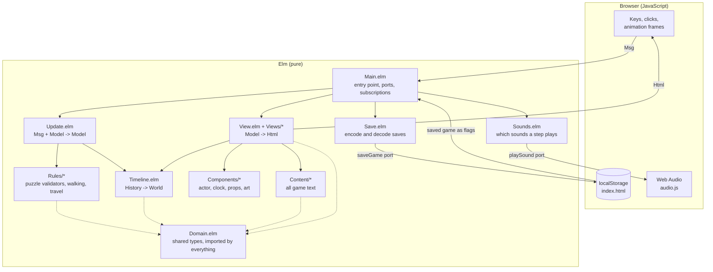

# Christmas Rewrite
 
*Every decade has its mistakes. Every diary remembers them.*
 
A cosy, story based puzzle adventure written in [Elm](https://elm-lang.org). You walk around a side-view family bookshop and travel back through three diaries to change its history.
 
**Made in 24 hours for the University of Bristol Game Jam 2026** (theme: time), entered in the functional programming category.
 
**[Play it in your browser](https://periyr.github.io/Christmas-Rewrite/)** · about 10–15 minutes · no install needed
 
## The game
 
On Christmas Eve, Edwin Hale is closing his family's bookshop for good when he finds three old diaries: his grandfather Walter's, his father Henry's and his own. Each one takes him back to the decade where something went wrong.
 
| Year | You play as | The puzzle |
|---|---|---|
| 1950 | Walter | Plan the repair week on a budget of four planks and £10 |
| 1973 | Henry | Stage a shadow-puppet story by torchlight during a power cut |
| 1998 | Edwin | Find the one book a customer's daughter loved, from a picture, a remembered line and an inscription |
 
What happens in one decade changes the clues in the next and the shop you come back to. Save all three and the shop reopens at midnight. Any failure leads to a different ending, and you can reopen any diary to try again.
 
## Controls
 
| Action | How |
|---|---|
| Walk | Hold **A** / **D** or **←** / **→** |
| Use what's nearby | **E** when the prompt appears, or click the object's label |
| Move a puzzle piece | Click to pick it up, then click where it goes |
| Continue the story | **Enter**, or click the button |
| Submit a puzzle | Its button: **Finish week**, **Perform the story** or **Send this book** |
 
Reading clues and rearranging pieces is always free. Only submitting uses an attempt: two each in 1950 and 1973, one in 1998. Every puzzle screen has a **Help** button.
 
## Run it locally
 
You need [Node.js](https://nodejs.org) 18 or newer. Works on Mac, Windows and Linux.
 
```bash
git clone https://github.com/periyr/Christmas-Rewrite.git
cd Christmas-Rewrite
npm install      # once
npm start        # preview at http://localhost:8000, reload the page to rebuild
```
 
| Command | What it does |
|---|---|
| `npm start` | Local preview at `http://localhost:8000`. Reloading the page rebuilds the game. |
| `npm test` | Runs the Elm test suite |
| `npm run build` | Static debug build into `build/` |
| `npm run release` | Optimised, checked build into `release/christmas-rewrite/` |
 
To make a submission build, run `npm test`, then `npm run release`, and zip the contents of `release/christmas-rewrite/` so that `index.html` is at the top level. To play that build, open `release/christmas-rewrite/index.html` in a browser or serve the folder with any static file server.
 
## Architecture
 
The game follows the Elm Architecture: one model, one pure `update` function, one `view` function. The browser only supplies inputs, and JavaScript is used for just two things: saving to `localStorage` and playing sound.
 

 
One turn of the loop:
 
1. The browser reports a key press, click or animation frame, and `Main` turns it into a `Msg`.
2. `Update.update` takes the `Msg` and the current `Model` and returns a new `Model`. It asks `Rules/*` to judge puzzles and `Timeline` to record finished chapters.
3. `View` draws the new `Model` as HTML and SVG.
4. `Main` compares the model before and after the step. If progress changed, `Save` writes it through the `saveGame` port. `Sounds.forStep` picks any sound effects and sends their names through the `playSound` port.
### Design ideas
 
- **State never changes in place.** Every action produces a new game state from the old one, so double-clicking or clicking during feedback can't spend an extra attempt or record a chapter twice.
- **Puzzle checks are pure functions.** Each puzzle has a validator in `src/Rules/` that takes a finished arrangement and returns the list of broken rules. It knows nothing about the interface.
- **The world is rebuilt from history.** The only progress stored is the ordered list of finished chapters. The present-day shop, the 1973 script, the 1998 clue and the ending are all calculated from that list, so the same history always gives the same world.
- **Rewinding is just filtering a list.** Reopening a diary removes that chapter and every later one from the history, and the world is rebuilt from what's left.
- **Types instead of strings.** Eras, books, tasks and clues are custom types in `Domain.elm`, so the compiler catches a missing case.
### Project structure
 
```
src/
  Main.elm         Entry point: ports, subscriptions, title screen
  Domain.elm       Shared types (the team's contract); imports nothing from the project
  Update.elm       The pure update function
  Timeline.elm     Chapter history and everything derived from it
  Save.elm         Save and load as JSON
  Sounds.elm       Chooses sounds by comparing the model before and after a step
  View.elm         Picks the screen for the current phase
  Rules/           Puzzle validators, attempts, walking, time travel
  Views/           One module per screen (shop, repair board, shadow stage...)
  Components/      Reusable pieces: actor, clock, props, art
  Content/         All game text: clues, diaries, slides, endings
tests/             elm-test suites
public/            index.html, styles.css, audio.js, assets/
scripts/           Node build, serve and release scripts
docs/              Walkthrough, submission copy, AI usage, playtest log
.github/workflows/ CI and GitHub Pages deploy
```
 
## Testing
 
`npm test` runs about 300 automated tests. Because the puzzle rules are pure functions, the tests can check every possible answer:
 
- all 2,520 possible repair weeks (exactly six are accepted)
- all 36 shadow stagings
- all 720 shelf orders (exactly four are accepted)
- whole games through all eight pass/fail combinations of the three chapters
Browser playtests are logged in [docs/PLAYTEST.md](docs/PLAYTEST.md).
 
## Continuous integration and deployment
 
[`.github/workflows/ci.yml`](.github/workflows/ci.yml) runs `npm test` and `npm run release` on every push to `main` and on every pull request. A push to `main` also publishes `release/christmas-rewrite/` to GitHub Pages at <https://periyr.github.io/Christmas-Rewrite/>.
 
One-time setup for a fork: in the repository on GitHub, open **Settings → Pages** and set **Source** to **GitHub Actions**.
 
## How we used AI
 
We used Claude (mostly through Claude Code) and Google Gemini, and we've written down exactly where. The full record is in **[docs/AI_USAGE.md](docs/AI_USAGE.md)**, including example prompts.
 
| Area | Who did it |
|---|---|
| Game idea, story, characters, puzzles and their rules | The team, no AI |
| Code and debugging | The team, with Claude Code as an assistant. We mostly use claude code as an assistant to debug and write tests to cover edge cases. No large chucnks of code was copy/pasted from AI. All the recommendations given by AI was researched and tested throughly by us |
| Game text | Written by the team; Claude Code only polished the wording |
| Room backgrounds, book covers, puppets | Generated with Google Gemini from our prompts and palette, then checked and edited |
| Props, family photograph, closure notice | SVG made with Claude's help |
| Music and sound effects | Generated in code by Claude Code with the Web Audio API. There are no sound files. |
 
The game itself uses no AI and makes no network calls while you play.
 
## Documentation
 
| Doc | What's in it |
|---|---|
| [docs/WALKTHROUGH.md](docs/WALKTHROUGH.md) | How to play and every solution (**spoilers**) |
| [docs/SUBMISSION.md](docs/SUBMISSION.md) | Game description, controls and full credits |
| [docs/AI_USAGE.md](docs/AI_USAGE.md) | Where AI was and wasn't used |
| [docs/PLAYTEST.md](docs/PLAYTEST.md) | Playtest log |
| [public/assets/ASSETS.md](public/assets/ASSETS.md) | Asset list and palette |
 
## Team
 
| Name | Role |
|---|---|
| Avissa Rasoulinia | Core logic, rules and integration |
| Defne Göçken | Presentation and interaction |
| Peri Yarci | Content, assets and player clarity |
| Ata Karasoy | Debugging and small implementation details |
 
## Built with
 
- [Elm 0.19.1](https://elm-lang.org) with `elm/browser`, `elm/html`, `elm/json` and `elm/random`
- [elm-test](https://github.com/elm-explorations/test) for testing
- HTML, CSS and SVG for presentation
- The Web Audio API for sound and music ("Silent Night", Franz Gruber, 1818, public domain)
- Node.js for the build scripts
- GitHub Actions and GitHub Pages for CI and hosting
