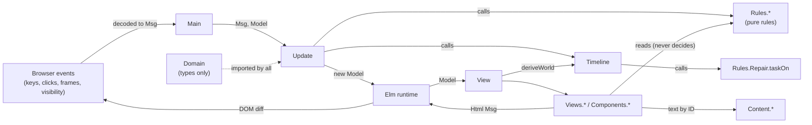
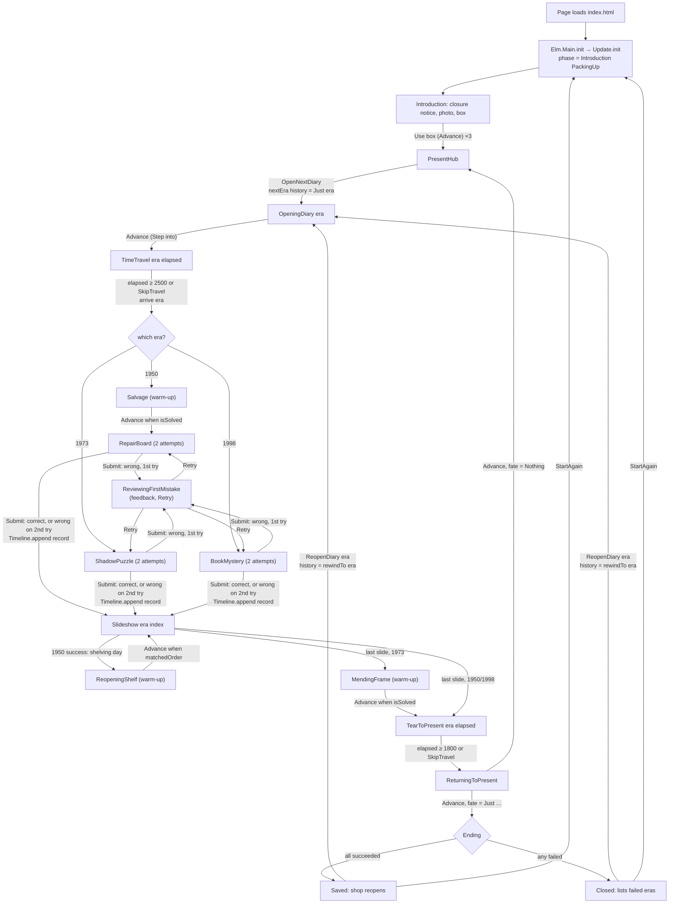
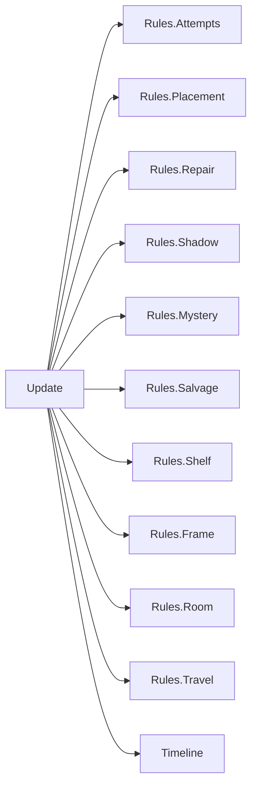
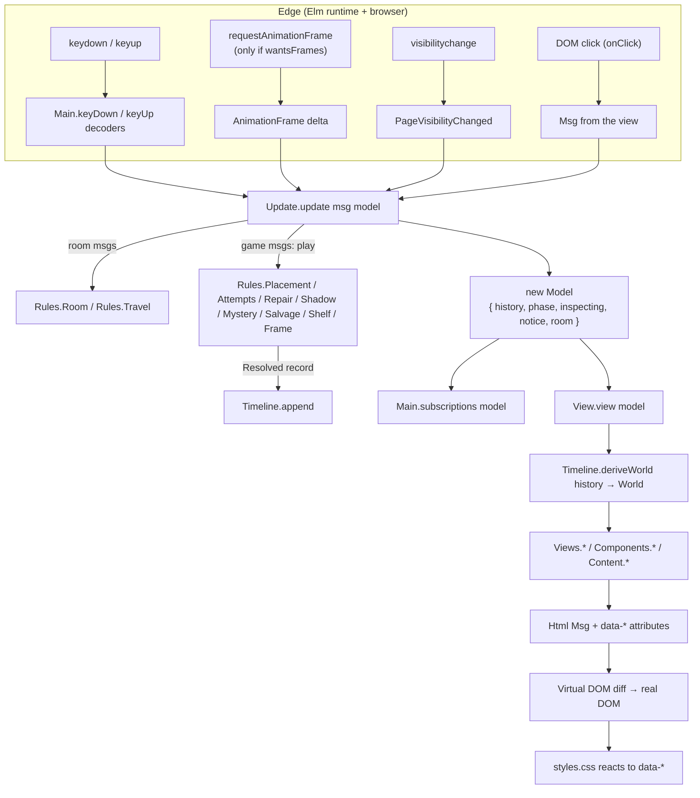

# One More Christmas: technical deep dive

A complete guide to how the game is built: its files, its architecture, every mechanic, the functional programming behind it, and how to defend it in front of judges.

- **Source of truth:** the code in `src/`, `public/`, `scripts/` and `tests/` at commit `d4bf76e` (8 November). Where the README, `CONTRACT.md` or the brief disagree with the code, this document follows the code and says so.
- **Line numbers** refer to that commit. They drift as the code changes; the function names don't.
- **What I could not do:** the Elm package server is blocked in the environment this was written in, so I could not compile the game or run `npm test`. Every claim here comes from reading the source. Test counts are counted from the test files, not from a run.

---

## Contents

1. [The repository](#part-1-the-repository)
2. [The game from start to finish](#part-2-the-game-from-start-to-finish)
3. [Every mechanic and its logic](#part-3-every-mechanic-and-its-logic)
4. [Functional programming in this game](#part-4-functional-programming-in-this-game)
5. [File-by-file walkthrough](#part-5-file-by-file-walkthrough)
6. [Data flow and state](#part-6-data-flow-and-state)
7. [Technical decisions](#part-7-technical-decisions)
8. [Performance, testing and reliability](#part-8-performance-testing-and-reliability)
9. [Judge preparation](#part-9-judge-preparation)

---

# Part 1: The repository

## 1.1 What is in it

The game is a single-page browser game written in **Elm 0.19.1**. Elm compiles to one JavaScript file. Presentation is HTML elements, a large CSS file, SVG drawings and JPEG room pictures. Node.js is only used for build scripts; it is not part of the game.

```
Christmas-Rewrite/
├── src/                     Elm source: the whole game (≈8,700 lines)
│   ├── Main.elm             Entry point: wires init/update/view/subscriptions
│   ├── Domain.elm           Every shared type: Model, Msg, Phase, History, World…
│   ├── Update.elm           The single pure update function (the state machine)
│   ├── Timeline.elm         History → World derivation, rewind, slides, ending
│   ├── View.elm             Root view: picks the screen for the current phase
│   ├── Fixtures.elm         Ready-made models for tests (not used by the game)
│   ├── Rules/               Pure game rules, one module per mechanic
│   │   ├── Attempts.elm     The two-attempt rule shared by the three main puzzles
│   │   ├── Placement.elm    Click-to-select / click-to-place logic (generic)
│   │   ├── Repair.elm       1950 planning board: costs, budget, validator
│   │   ├── Salvage.elm      1950 warm-up: books into crates
│   │   ├── Shelf.elm        1950 celebration: four accepted shelf orders
│   │   ├── Books.elm        Fixed facts about the nine 1950 books
│   │   ├── Shadow.elm       1973 shadow story: scripts and validator
│   │   ├── Frame.elm        1973 broken-frame warm-up
│   │   ├── Mystery.elm      1998 forgotten book: which candidate has which detail
│   │   ├── Room.elm         Walking: coordinates, hotspots, movement maths, keys
│   │   └── Travel.elm       Timing of the trip into a diary and the tear home
│   ├── Views/               One module per screen or panel (HTML)
│   ├── Components/          Reusable view pieces: Placement UI, Actor, Art, Props, Clock
│   └── Content/             All player-facing text, keyed by Domain IDs
├── public/                  Copied as-is into the build
│   ├── index.html           Page shell, shared SVG symbols, <svg-art> element, Elm start-up
│   ├── styles.css           All styling, room tokens per era, animations (≈2,250 lines)
│   └── assets/              Room JPEGs, SVG covers, sprites, props + ASSETS.md manifest
├── tests/                   elm-test suites (18 files, ≈320 test cases)
├── scripts/                 Node build, preview server and release checker
├── docs/                    Walkthrough, playtest notes, submission copy, asset generators
├── work/ui-preview.html     A static HTML mock-up from early UI work (not used by the build)
├── CONTRACT.md              Team contract v1.7: types, ownership, behaviour per version
├── one-more-christmas-shared-plan.md   The original design brief
├── visual-and-movement-update.md       The later brief that added walking
├── elm.json                 Elm dependencies (elm/browser, core, html, json)
└── package.json             npm scripts and dev tools (elm, elm-test)
```

**Ignore when studying the code:** `node_modules/`, `elm-stuff/` (compiler cache), `build/` and `release/` (generated by the scripts; all four are in `.gitignore`), `package-lock.json` (generated), and `work/ui-preview.html` (a static mock-up that no script references).

## 1.2 Repository map

### Configuration and scripts

| File | Responsibility | Important contents | Depends on | When is it used? |
|---|---|---|---|---|
| `elm.json` | Declares the Elm application and its packages | Direct deps: `elm/browser` 1.0.2, `elm/core` 1.0.5, `elm/html` 1.0.0, `elm/json` 1.1.3. Test dep: `elm-explorations/test` 2.2.1. No `elm/svg`. | The Elm package server, at build time | Every compile and test run |
| `package.json` | npm commands and dev tools | `build`, `start`, `test`, `release` scripts; `elm` and `elm-test` as devDependencies | Node 18+ | Whenever a developer builds or tests |
| `scripts/build.mjs` | Compiles `src/Main.elm` to `build/elm.js` and copies `public/` beside it | `build({ optimize })`; finds the Elm binary from the npm package; writes a fallback `index.html` if `public/index.html` is missing | `elm` binary, `public/` | `npm run build`, and on every page load in `npm start` |
| `scripts/serve.mjs` | Local preview server on port 8000 | Rebuilds on every request for `/` or `/index.html`; shows compile errors in the browser; serves `build/` with MIME types; blocks paths outside `build/` | `build.mjs` | `npm start` |
| `scripts/release.mjs` | Optimised, checked build for submission | Builds with `--optimize`, copies to `release/one-more-christmas/`, then scans `index.html`, `styles.css` and `elm.js` for `assets/…` references and fails if any file is missing, any path is absolute (`/assets/`) or anything mentions localhost | `build.mjs` | `npm run release` |
| `.gitignore` | Keeps generated output out of git | `node_modules/`, `elm-stuff/`, `build/`, `release/` | — | Always |

### Elm core (Person A in the contract)

| File | Responsibility | Important contents | Depends on | Used by |
|---|---|---|---|---|
| `src/Main.elm` | Program entry point and the only place browser events enter | `main` (`Browser.element`), `subscriptions`, the `keyDown`/`keyUp` JSON decoders | `Update`, `View`, `Rules.Room`, `Rules.Travel`, `Domain` | The compiled page (`Elm.Main.init` in `index.html`) |
| `src/Domain.elm` | The shared vocabulary: every type the team agreed on | `Model`, `Msg`, `Phase`, `Transition`, `History`, `ChapterRecord`, `World`, `Placement`, `PlacementAction`, `Attempts`, `Violation`, `Player`, `Room`, all puzzle IDs, content record types | Nothing in the project (deliberately, so no import cycles) | Every other module |
| `src/Update.elm` | The state machine: turns `(Msg, Model)` into a new `Model` | `init`, `update`, `play`, `submit`, `applySubmit`, `advance`, `goTo`, `arrive`, `walk`, `approach`, `useHotspot`, `movePuzzle`, `settle` | `Rules.*`, `Timeline`, `Domain` | `Main`, `View` (only `startChapter`), tests |
| `src/Timeline.elm` | Everything computed from chapter history | `eras`, `recordFor`, `outcomeOf`, `nextEra`, `append`, `rewindTo`, `fate`, `deriveWorld`, `slides` | `Rules.Repair`, `Domain` | `Update`, `View`, many views, `Rules.Travel`, tests |
| `src/Fixtures.elm` | Ready-made models (a board half filled in, a first mistake under review, each script variant…) | `repairBoardInProgress`, `repairFirstAttemptFailed`, `shadowOriginalScript`, `mysteryFollowUpEmail`, … | `Update`, `Rules.*`, `Timeline` | Tests only. No game module imports it. |
| `src/Rules/Attempts.elm` | The shared two-attempt rule | `SubmitResult` (`Ignored`, `Incomplete`, `FirstMistake`, `Resolved`), `submit`, `retry`, `attemptsUsed`, `maxAttempts = 2` | `Domain` | `Update.submit`, `Views.Common` |
| `src/Rules/Placement.elm` | Generic click-to-select/click-to-place, with no puzzle answers | `empty`, `apply`, `placeInto`, `slotOf`, `itemIn`, `inTray` | `Domain` | `Update`, every arrangement rule module, `Components.Placement` |
| `src/Rules/Repair.elm` | 1950 main puzzle | `cost`, `budget`, `spent`, `remaining`, `complete`, `validate`, `taskOn`, `dayOf` | `Rules.Placement` | `Update`, `Timeline.slides`, `Views.RepairBoard` |
| `src/Rules/Salvage.elm` | 1950 warm-up | `crateSlots`, `misplaced`, `isSolved` | `Rules.Books` | `Update.advance`, `Views.Salvage` |
| `src/Rules/Shelf.elm` | 1950 celebration | `order`, `matchedOrder` | `Rules.Placement` | `Update.advance`, `Views.Shelf` |
| `src/Rules/Books.elm` | Facts about the nine books | `condition`, `height`, `colour`, `allBooks` | `Domain` | `Rules.Salvage`, views, tests |
| `src/Rules/Shadow.elm` | 1973 main puzzle | `script`, `complete`, `validate`, `accepts` | `Rules.Placement` | `Update.submit`, `Views.ShadowStage` |
| `src/Rules/Frame.elm` | 1973 broken-frame warm-up | `accepts` (piece n only fits gap n), `isSolved` | `Domain` | `Update`, `Views.Frame` |
| `src/Rules/Mystery.elm` | 1998 main puzzle | `matches`, `validate`, `complete` | `Domain` | `Update.submit`, `Views.BookTable` |
| `src/Rules/Room.elm` | The walking room | Room geometry constants, `position`, `hotspots`, `canWalk`, `nearby`, `press`, `release`, `step`, `stop`, `isMoving`, key mapping | `Domain` | `Update`, `Main`, `Rules.Travel`, `Views.Room`, `Components.Props` |
| `src/Rules/Travel.elm` | Timing of both trips | `duration` 2500, `bookOpen` 500, `arrival` 1800, `returnDuration` 1800, `step`, `yearAt`, `isTravelling`, `wantsFrames` | `Rules.Room`, `Timeline` | `Main.subscriptions`, `Update`, `View`, `Views.TimeTravel` |

### Elm presentation (Person B)

| File | Responsibility | Important contents | When is it used? |
|---|---|---|---|
| `src/View.elm` | Root view. Derives the `World` once, picks the screen for `model.phase`, adds the wall clock, the clue overlay and the `data-*` attributes CSS uses to dress each room | `view`, `screen`, `stageAttributes`, `eraStageAttributes`, `inspection`, `wallClock`, `tearRooms` | Every render |
| `src/Views/Room.elm` | The walking room: room picture, props, player sprite, hotspot labels, bottom bar, open panel | `view`, `Scene` (behind/front/line/panel), `hotspots`, `hotspot`, `bottomBar`, `person` | Every phase with a room |
| `src/Views/Shop.elm` | Intro narration, present hub, diary passage, "Back to the present", ending sheet with Reopen buttons | `introduction`, `presentHub`, `openingDiary`, `returning`, `ending` | Non-puzzle phases |
| `src/Views/Salvage.elm`, `RepairBoard.elm`, `Shelf.elm`, `ShadowStage.elm`, `Frame.elm`, `BookTable.elm` | One panel per puzzle | Each has `view`, a `placementConfig` and a `hint` | When that puzzle's panel is open |
| `src/Views/Slideshow.elm` | Plays the slides after a chapter; sets the room attributes for each slide (roof patched, lights down…) | `view`, `stageAttributes`, `lights`, `atShelvingPause` | `Transition (Slideshow era index)` |
| `src/Views/TimeTravel.elm` | The trip into a diary, drawn entirely from `elapsed` | `view`, `book`, `leaf`, `year`, `clock`, easing helpers `between`/`smooth` | `Transition (TimeTravel era elapsed)` |
| `src/Views/Tear.elm` | The tear home, drawn from `elapsed`, as a CSS `clip-path` polygon | `view`, `halfWidth`, `tearShape`, `jags` | `Transition (TearToPresent era elapsed)` |
| `src/Views/Common.elm` | Shared widgets | `attemptsDisplay`, `statusLine`, `documentSheet`, `feedback`, `numbered`, `helpButton`, `closePanel`, `clueNote` | Many screens |
| `src/Views/Labels.elm` | `eraYear : Era -> String` | — | Badges, buttons, attributes |
| `src/Components/Placement.elm` | Reusable placement UI (slot, group, tray). Only dispatches `PlacementAction`s | `Config`, `slot`, `group`, `tray`, `emptySpace`, `filled` | Salvage, board, shelf, shadow stage |
| `src/Components/Actor.elm` | Draws the walking sprite from the `Player` record | `view`, `pose` (walk frame from x position) | Every room |
| `src/Components/Art.elm` | Images and inline SVG strings | `room`, `bookCover`, `diaryCover`, `cutout`, `candidateCover`, `icon`, `arrows`, `svgArt` | Throughout |
| `src/Components/Props.elm` | Objects each chapter adds to the room (torch, sheet, computer, parcels…) | `forPhase`, `forSlide`, `shadowRoom` | Room and slideshow |
| `src/Components/Clock.elm` | The wall clock, drawn in SVG; ticking is CSS | `view`, `face`, hands, `label` | Every stage (first child) |
| `public/index.html` | Page shell | Shared SVG `<symbol id="room-overlays">` (stain, hole, patch, rubble, crates, timber, bucket, broken window, rain, frame-gone, frame-tape), task icons, the `svg-art` custom element, `Elm.Main.init` | Page load |
| `public/styles.css` | All styling | Era colour tokens (`[data-era="…"]`), room picture per era, overlay switches (`--show-stain` etc.), panels, sheets, animations, reduced-motion rules | Always |

### Content and assets (Person C)

| File | Responsibility |
|---|---|
| `src/Content/Clues.elm` | `clue : World -> ClueId -> Document`. Text for every inspectable object; reads the `World` so the script, sketch, emails and hub props change with history. |
| `src/Content/Diaries.elm` | `passage : World -> Era -> Document`. Diary text, with variants for not-revisited, failed and succeeded. |
| `src/Content/Slides.elm` | `slide : World -> Slide -> Document`. Text for weekday, performance, service and consequence slides. |
| `src/Content/Feedback.elm` | Friendly text for every `Violation` and `Notice`. |
| `src/Content/Endings.elm` | `saved` document and `missing : Era -> Document` for each failed chapter. |
| `src/Content/Repair.elm`, `Shadow.elm`, `Mystery.elm`, `Books.elm`, `Frame.elm`, `Shelf.elm`, `Intro.elm`, `Room.elm`, `Characters.elm`, `Words.elm` | Labels and short texts per puzzle or object (task cards, scene settings, candidate pages, hotspot labels, day and scene names). |
| `public/assets/` | 3 room JPEGs (`room-1950`, `room-1973`, `room-present`) plus `room-saved`, ≈55 SVGs (book covers, damage overlays, diaries, puppets, candidates, 12 player sprites, room props), and `ASSETS.md` (manifest, origins and licences). |
| `docs/asset-sources/*.mjs` | Node scripts that generated some SVGs (the chibi family sprites, family photo, closure note). Not part of the build. |
| `docs/WALKTHROUGH.md`, `PLAYTEST.md`, `SUBMISSION.md` | Spoiler walkthrough, playtest log, submission copy and credits. |

## 1.3 The architecture

What is actually present, without forcing labels onto it:

1. **The Elm Architecture (TEA).** One `Model`, one `Msg` type, one `update : Msg -> Model -> Model`, one `view : Model -> Html Msg`, and `subscriptions` for browser events. The Elm runtime owns the loop. This is the backbone.
2. **A functional core with a thin imperative shell.** Every game decision lives in pure Elm functions. The only imperative code is the Elm runtime itself, a five-line custom element in `index.html` that sets `innerHTML`, and the Node build scripts.
3. **Layered by responsibility, not by objects.**
   - `Domain`: types only.
   - `Rules.*`: pure rule functions, no HTML.
   - `Timeline`: derivation from history.
   - `Update`: orchestration (which rule to call for which message in which phase).
   - `View`, `Views.*`, `Components.*`: HTML from state.
   - `Content.*`: text keyed by IDs.
4. **A finite state machine.** `Phase` is a closed set of states. `Update` is the transition function, and messages that don't fit the current phase are ignored.
5. **Event sourcing in miniature.** Progress is stored only as an ordered log of results (`History = List ChapterRecord`). Everything else about the world is recomputed from that log (`Timeline.deriveWorld`).
6. **Component-style view helpers, but no component state.** `Components.Placement` and `Components.Actor` are reusable functions, not stateful objects; they read state passed in and return HTML plus messages.
7. **Not object-oriented.** There are no classes, no methods and no mutable objects. Elm doesn't have them.
8. **Event-driven only at the edge.** Clicks, keys, animation frames and page visibility become `Msg` values. Inside, everything is function calls.

How the layers talk:



The rule of thumb the team set in `CONTRACT.md` and kept: **views may read rules (for display arithmetic, positions, what's in a slot) but never call a validator before submission.** `Views.RepairBoard` says so in its module comment: "Everything about correctness comes from puzzle.attempts, never from calling the validator."

---

# Part 2: The game from start to finish

## 2.1 Start-up

1. **The browser loads `index.html`** (from `build/` or `release/one-more-christmas/`).
   - `<link rel="stylesheet" href="styles.css">` loads the styles.
   - Two `<link rel="preload" as="image">` lines start downloading `room-present.jpg` and `room-1950.jpg` early.
   - An invisible `<svg>` defines shared `<symbol>`s: `room-overlays` (everything that changes inside a room) and the task icons.
2. **The `svg-art` custom element is registered** (`index.html:139-142`). Whenever its `markup` attribute changes, it sets its own `innerHTML` to that string. Elm uses it to show SVG without the `elm/svg` package.
3. **`elm.js` runs**, then `Elm.Main.init({ node: document.getElementById("app") })`.
4. **Elm calls `init`** from `main` (`src/Main.elm:22-29`): `\_ -> ( Update.init, Cmd.none )`. The flags are `()`, so nothing comes in from JavaScript.
5. **`Update.init`** (`src/Update.elm:28-35`) is a plain value:
   ```elm
   { history = []
   , phase = Introduction PackingUp
   , inspecting = Nothing
   , notice = Nothing
   , room = Rules.Room.initialRoom   -- x = 160, facing right, standing still
   }
   ```
6. **Elm calls `View.view init`.** `view` derives the world (`Timeline.deriveWorld []`: everything `NotRevisited`, `nextDiary = Just Repairs1950`, `fate = Nothing`), puts `data-era="present"` and `data-premises="original"` on the stage, adds the wall clock, and calls `screen`, which for `Introduction PackingUp` draws the room with the intro narration in front.
7. **Elm calls `subscriptions init`** (`src/Main.elm:32-45`). It subscribes to keydown, keyup and visibility. It does **not** subscribe to animation frames, because `Rules.Travel.wantsFrames` is false while nobody is walking or travelling.
8. **Assets load lazily.** There is no loading screen or asset manager. The CSS background (`.room-art`) and `` tags fetch their files when first shown; the browser caches them.
9. **From now on the game is reactive.** Nothing runs until an event arrives: a key, a click on a button (via `onClick`), an animation frame (only while moving), or the tab being hidden.

## 2.2 The player's journey

1. **Introduction (present day).** `Introduction PackingUp`: Edwin can walk; three hotspots (closure notice, box beneath the counter, family photograph). Using the box sends `Advance` → `DiariesFound` → `ClockStopped` (the wall clock stops at 23:59) → `PresentHub`.
2. **Present hub.** The diary on the counter glows. Using it sends `OpenNextDiary`; `Timeline.nextEra` picks the first era without a record.
3. **Opening a diary.** `Transition (OpeningDiary era)` shows that diary's passage (text depends on the `World`). "Step into" sends `Advance`.
4. **Trip into the past.** `Transition (TimeTravel era 0)`. Animation frames push `elapsed` forward; at 2,500 ms (or on Skip) `Update.arrive` enters the chapter via `startChapter era`, with a fresh room.
5. **1950.** Salvage (warm-up, unlimited) → repair board (main puzzle, two attempts) → slideshow of the week. On a successful week the slideshow pauses on shelving day for the reopening shelf (warm-up), then resumes. A failed week shows one consequence slide.
6. **Tear home.** After the last slide, `Transition (TearToPresent era 0)` for 1,800 ms, then `ReturningToPresent` ("Back to the present"), then `PresentHub` with the next diary glowing.
7. **1973.** Shadow stage (main puzzle; which script is correct depends on 1950). Slideshow (three performance slides, or one consequence). Then, whatever the outcome, the photograph falls: `MendingFrame` (warm-up, nine glass pieces). Then the tear home.
8. **1998.** Four candidate books (main puzzle; where the inscription clue comes from depends on 1973). One slide, tear home.
9. **Ending.** After the third chapter, `ReturningToPresent` → `Advance` sees `Timeline.fate` is known and goes to `Ending`. Saved if all three succeeded; closed otherwise, with one explanation per failed era.
10. **Replay.** From the ending: `ReopenDiary era` (keeps earlier chapters, clears that one and later ones) or `StartAgain` (back to `init`).

## 2.3 Execution flow



**Step notes.**

- **Introduction → PresentHub:** `Update.advance` handles the three intro steps one at a time (`src/Update.elm:583-591`). The box hotspot sends `Advance` through `useHotspot` (`BoxSpot -> settle (play Advance stopped)`).
- **OpenNextDiary:** handled only in `PresentHub` (`src/Update.elm:260-271`). If no era is left it goes to `Ending`, though in normal play the ending is reached from `ReturningToPresent` first.
- **TimeTravel:** each `AnimationFrame delta` calls `Rules.Travel.step`. `isComplete` (≥ 2500) calls `arrive`. `SkipTravel` calls `arrive` directly, so both paths produce the same state.
- **Main puzzles:** `Submit` → `Update.submit` → `Rules.Attempts.submit` with that puzzle's `complete` and `validate`. Four results: `Ignored`, `Incomplete`, `FirstMistake`, `Resolved`.
- **Slideshow:** `Advance` moves `index + 1`. The shelving-day pause and the 1973 frame are special cases in `advance` (`src/Update.elm:613-634`).
- **ReturningToPresent:** `Advance` checks `Timeline.fate model.history`: `Nothing` means more chapters remain → hub; `Just _` → `Ending` (`src/Update.elm:643-648`).
- **Rewind:** `ReopenDiary era` is accepted only in `Ending` and goes to `OpeningDiary era` with `Timeline.rewindTo era` applied to history.

## 2.4 One interaction traced through the code: placing a repair card

The player has the repair board open, has clicked the "Patch the roof" card (it is now selected) and clicks the empty Monday column.

1. **The view built the button.** `Views.RepairBoard.dayColumn` calls `Components.Placement.slot config "Monday" (OnDay Monday)`. Because `Rules.Placement.itemIn (OnDay Monday)` is `Nothing`, `slot` calls `emptySpace config label (PlaceSelected (OnDay Monday))`, which renders:
   ```elm
   button [ ..., onClick (config.toMsg action) ] [ text "Place here" ]
   ```
   `config.toMsg` is `BoardMove` (`Views.RepairBoard.placementConfig`), so the click message is `BoardMove (PlaceSelected (OnDay Monday))`.
2. **The Elm runtime** receives the DOM click, finds the handler's message, and calls `update` with it. (`Main.main` wraps it: `update = \msg model -> ( Update.update msg model, Cmd.none )`.)
3. **`Update.update`** (`src/Update.elm:97`): `BoardMove` is not a room message, so it hits the last branch, `_ -> settle (play msg model)`.
4. **`Update.play`** (`src/Update.elm:196-202`): the phase is `RepairBoard puzzle`, so it calls
   ```elm
   movePuzzle RepairBoard Rules.Repair.accepts action puzzle model
   ```
5. **`Update.movePuzzle`** (`src/Update.elm:464-473`): if first-attempt feedback is open (`isReviewing puzzle`), nothing changes. Otherwise:
   ```elm
   ( arrangement, notice ) = Placement.apply accepts action puzzle.arrangement
   ```
6. **`Rules.Placement.apply`** (`src/Rules/Placement.elm:140`): the action is `PlaceSelected slot` and `selected = Just PatchRoof`, so it calls `placeInto accepts PatchRoof (OnDay Monday) placement`.
7. **`placeInto`** (`src/Rules/Placement.elm:193-226`): `Rules.Repair.accepts` says any known slot is fine. The slot is empty, so it returns
   ```elm
   ( { placed = without PatchRoof placement.placed ++ [ ( PatchRoof, OnDay Monday ) ], selected = Nothing }, Nothing )
   ```
   `without` first removes the card from wherever it was, so a card can never be in two places.
8. **Back in `movePuzzle`**, a new model is built with record-update syntax: `{ model | phase = RepairBoard { puzzle | arrangement = arrangement }, notice = notice }`. The old model is untouched.
9. **`settle`** (`src/Update.elm:361-367`) checks `Rules.Room.canWalk`. The panel is open, so the player is stopped (held keys and target cleared). It already was, so nothing visible changes.
10. **The runtime** stores the new model and schedules `View.view` on the next animation frame. `subscriptions` is re-evaluated too; still no frames needed.
11. **`View.view`** derives the world again, calls `screen`, which calls `Views.Room.view` with the board panel (`station (Views.RepairBoard.view world puzzle model.notice)`).
12. **`Views.RepairBoard.view`** renders Monday holding the roof card, and the ledger calls `Rules.Repair.spent` (`{ timber = 2, pounds = 0 }`) and `remaining` (`{ timber = 2, pounds = 10 }`). These are plain arithmetic, not a correctness judgement.
13. **The virtual DOM diff** updates only the changed nodes: the Monday slot, the tray position, the ledger numbers.

---

# Part 3: Every mechanic and its logic

Each mechanic below exists in the code. Mechanics the game does **not** have: randomness (there is none anywhere), scoring or points, collision detection between objects, a countdown timer, saving to storage, and sound.

## 3.1 Phases and transitions (the state machine)

1. **Player view:** the game moves from screen to screen: intro, shop, diary, trip, puzzle, slides, tear, back, ending.
2. **Where:** `Domain.Phase` and `Domain.Transition`; transitions in `Update.advance`, `Update.applySubmit`, `Update.arrive`, `Update.backInThePresent`, `OpenNextDiary`, `ReopenDiary`, `StartAgain`.
3. **Inputs:** a `Msg` and the current `Model`.
4. **Conditions:** each transition pattern-matches on `model.phase`. Example: `ReopenDiary era` only works when `model.phase` is `Ending`; anywhere else it returns `model` unchanged.
5. **Output:** a new `Model` with a new `phase`.
6. **State change:** almost every change goes through `goTo` (`src/Update.elm:63-70`), which also clears the open clue, the notice and the panel, and stops the player. That one function is why no overlay can leak from one screen into the next.
7. **UI:** `View.screen` has one `case` branch per phase.
8. **Edge cases:** a message that doesn't fit the phase (a double click on a button that just disappeared, `Retry` with no feedback open, `SkipTravel` outside a trip) falls through to `model`.
9. **Why it works:** puzzle phases carry their own state (`RepairBoard (MainPuzzle …)`), so leaving a phase throws its state away automatically. There is no "reset the puzzle" code to forget.

## 3.2 Placement (click to select, click to place)

1. **Player view:** click an item to pick it up, click a space to put it there. Used by salvage, the repair board, the shelf, the shadow stage and the frame.
2. **Where:** `Rules.Placement.apply` / `placeInto`; UI in `Components.Placement` (the frame has its own view in `Views.Frame` but uses the same rule).
3. **Inputs:** `accepts : item -> slot -> Bool` (supplied by each puzzle), a `PlacementAction`, and the current `Placement { placed : List (item, slot), selected : Maybe item }`.
4. **Logic (`apply`):**
   - `SelectItem item`: if it's already selected, deselect; otherwise select it.
   - `PlaceSelected slot` with something selected → `placeInto`.
   - `PlaceSelectedInGroup slots` (a crate, "Not this week"): if the item is already in that group, just deselect. Else find the first slot in the group that accepts it and is empty. If none: `TargetFull` if the group accepts it at all, otherwise `DoesNotFitThere`.
   - `ReturnSelectedToTray`: remove the item from `placed`.
   - `ClearSelection`: deselect.
   - Anything with nothing selected: no change.
5. **Logic (`placeInto`):**
   ```
   if not (accepts item slot):            keep placement, notice DoesNotFitThere
   else if slot empty:                     move item there (remove from old place first)
   else if occupant is the item itself:    just deselect
   else (slot occupied by another item):
       if item came from a slot the occupant can use:  swap them
       else:                                          occupant goes back to the tray
   ```
6. **Output:** `( Placement, Maybe Notice )`. The notice is neutral; it never says whether an arrangement is right.
7. **State:** `Update.withPlacement` (warm-ups) or `Update.movePuzzle` (main puzzles) writes the new placement into the phase.
8. **UI:** `Components.Placement` shows "Place here" on every legal target when something is selected, and "Swap" on occupied ones. Every legal target looks the same, so selecting reveals nothing.
9. **Edge cases:** duplicates are impossible because `placeInto` always calls `without item` first; a full crate gives `TargetFull`; a prop into a character slot gives `DoesNotFitThere` (`Rules.Shadow.accepts`); moves are frozen while first-attempt feedback is open (`movePuzzle` checks `isReviewing`).
10. **Why it works:** the arrangement is a list of pairs, and every operation is "remove, then add". The `accepts` function is passed in, so the same code serves five puzzles without knowing any of their answers.

## 3.3 The two-attempt rule

1. **Player view:** each main puzzle allows two submissions. An incomplete board is refused for free. A first wrong answer shows what broke and lets you retry; a second wrong answer fails the chapter.
2. **Where:** `Rules.Attempts.submit` and `retry`; wired in `Update.submit` and `Update.applySubmit`.
3. **Inputs:** a config record `{ era, complete, validate, toFinal }` and the `MainPuzzle`.
4. **Logic:**
   ```
   case (puzzle.attempts, complete puzzle.arrangement) of
       (ReviewingFirstMistake _, _)  -> Ignored          -- feedback open: double click
       (_, Nothing)                  -> Incomplete       -- spends nothing
       (attempts, Just submission)   ->
           violations = validate submission
           used = attemptsUsed attempts + 1
           if no violations       -> Resolved (Succeeded, used)
           else if used < 2       -> FirstMistake violations
           else                   -> Resolved (Failed, used)
   ```
5. **Output:** a `SubmitResult`.
6. **State (`applySubmit`):** `Ignored` → unchanged; `Incomplete` → `notice = Just IncompleteSubmission`; `FirstMistake vs` → `attempts = ReviewingFirstMistake vs`; `Resolved record` → `history = Timeline.append record history` and `goTo (Slideshow record.era 0)`.
7. **UI:** `Views.Common.attemptsDisplay` shows tokens (`total − used`); `Common.feedback` lists numbered violations; the submit button is disabled while reviewing.
8. **Edge cases:** double click while feedback is open → `Ignored`; incomplete on the final attempt → still free; `Retry` outside feedback → `retry` returns the puzzle unchanged.
9. **Why it works:** `Attempts` is a custom type with three states instead of a counter plus a flag, so "reviewing feedback" and "how many used" can't disagree. Only `Resolved` touches history, so the first mistake stays local.

## 3.4 1950 salvage (warm-up)

1. **Player:** sort nine books into Fine / Needs repair / Too far gone crates (three spaces each).
2. **Where:** `Rules.Salvage` (+ `Rules.Books.condition`); `Views.Salvage`.
3. **Inputs:** the placement of `BookId` into `InCrate Condition Int`.
4. **Logic:** `misplaced` lists books sitting in a crate that isn't their `condition`. `isSolved` requires: nine placements, each book exactly once, no slot used twice, every slot a real one, and nothing misplaced.
5. **Output:** `Bool` / list of misplaced books.
6. **State:** `Advance` goes to a fresh `RepairBoard` only if `isSolved`; otherwise `notice = Just NotSolvedYet` and the player stays (`src/Update.elm:597-602`).
7. **UI:** this is a warm-up, so the view is allowed to show progress and mistakes immediately.
8. **Edge cases:** the order of moves and which space inside a crate don't matter (tested in `WarmUpTests`).
9. **Why:** only the final classification is checked, which is what the brief asks for.

## 3.5 1950 repair board (main puzzle)

1. **Player:** schedule five of seven task cards on Monday–Friday and put two in "Not this week", within 4 planks and £10, respecting the rain on Wednesday, the glass arriving on Wednesday, and the order rubble → shelves → books.
2. **Where:** `Rules.Repair`; `Views.RepairBoard`.
3. **Data:** `cost` per task (roof 2 planks; shelves 2 planks; glazing £6; sign £6 + 1 plank; board up 1 plank; rubble and books free). `budget = { timber = 4, pounds = 10 }`.
4. **`spent` / `remaining`:** sum the costs of cards on days only, with `List.foldl` in `totalCost`. Remaining may go negative; the view just shows the number.
5. **`complete`:** structural check. Seven placements, every slot used exactly once, every task used exactly once. Then it reads the five days and the two aside slots into a `WeekPlan`. Anything else is `Nothing` → `Incomplete`.
6. **`validate`** (`src/Rules/Repair.elm:230-315`) checks each rule once, by its root cause:

   | Rule | Condition in code | Violation |
   |---|---|---|
   | Roof | deferred → `GoalMissing WatertightRoof`; on Wednesday or later → `RoofAfterRain day` | |
   | Window | glazed before Wednesday → `GlassNotYetDelivered day`; not glazed and not boarded → `GoalMissing SealedWindow` | |
   | Shelves | not scheduled → `GoalMissing UsableShelves`; scheduled but rubble not on an earlier day → `MustComeBefore ClearRubble BuildShelves` | |
   | Books | not scheduled → `GoalMissing AllBooksShelved`; shelves scheduled but not earlier → `MustComeBefore BuildShelves ShelveBooks` (not blamed if shelves are already missing) | |
   | Timber | total planks on days > 4 → `TimberOverspent total` | |
   | Money | total pounds on days > 10 → `MoneyOverspent total` | |

   It returns `List.concat [ roof, window, shelves, books, timber, money ]`. The order matters: the first violation drives the consequence slide.
7. **Why there are exactly six valid weeks** (the maths a judge may ask about):
   - Roof and shelves are compulsory and cost 2 + 2 = 4 planks, the whole timber budget.
   - So boarding up (1 plank) and the sign (1 plank) can't be scheduled: both go to "Not this week".
   - That fixes the five scheduled tasks: roof, rubble, shelves, books, glazing.
   - Roof must be Monday or Tuesday (2 choices). Glazing must be on one of the three days from Wednesday (3 choices among those left). Rubble, shelves and books then fill the remaining three days in their only allowed order.
   - 2 × 3 = **6**.
   - The search space: an ordered choice of 5 cards from 7 for the five days = 7 × 6 × 5 × 4 × 3 = **2,520** weeks. `tests/RepairTests.elm` builds all 2,520 with `orderedSelections 5` and checks that exactly the brief's six pass.
8. **After resolution:** `Timeline.slides` turns a successful week into five `WeekdaySlide day task` plus `ReopeningSaturday`; a failure into one `ConsequenceSlide Repairs1950 firstViolation`.

## 3.6 1950 reopening shelf (warm-up, only after a successful week)

1. **Player:** arrange six books in any of four orders: small to tall, tall to small, rainbow, A–Z.
2. **Where:** `Rules.Shelf.order`, `matchedOrder`; `Views.Shelf`.
3. **Logic:** if all six positions hold exactly one book, read them left to right and compare with each of the four orders; return the first that matches.
4. **When it appears:** `Update.advance` on a slideshow slide that is `WeekdaySlide _ ShelveBooks` goes to `ReopeningShelf Placement.empty` (`src/Update.elm:618-621`). On solving, `shelvingSlideIndex` finds that slide's index in `Timeline.slides` and the slideshow resumes at `index + 1`, so shelving day is never replayed.
5. **Edge cases:** if 1950 failed there is no `ShelveBooks` slide, so no shelf. `Advance` before a match gives `NotSolvedYet`. Its result is never recorded; it can't change the 1950 outcome.

## 3.7 1973 shadow story (main puzzle)

1. **Player:** place one character and one prop cut-out on each of three scene panels to match the script.
2. **Where:** `Rules.Shadow`; `Views.ShadowStage`.
3. **Which script:** `Timeline.deriveWorld` sets `scriptVariant = OriginalScript` if 1950 succeeded, else `NeighboursRetelling`. `Update.submit` passes it in: `Rules.Shadow.validate (Timeline.deriveWorld model.history).scriptVariant`.
4. **`accepts`:** characters only in character slots, props only in prop slots.
5. **`complete`:** six placements, each slot once, each cut-out once, then `Maybe.map3 Staging (cast Scene1) (cast Scene2) (cast Scene3)`.
6. **`validate`:** for each scene, compare the `SceneCast` record with the script's; one `SceneConflictsWithScript scene` per mismatch.
7. **Maths:** 3! ways to assign characters × 3! ways to assign props = **36** stagings; each script accepts exactly one. A wrong staging always breaks **at least two** scenes: if only one scene were wrong, it would have to hold a different character or prop, but every cut-out is used exactly once, so the one it's missing must be in another scene, which is then wrong too.
8. **After resolution:** three `PerformanceSlide`s, or one consequence. Then the frame falls (next section). The 1973 outcome sets `world.tradition` and the 1998 `inscriptionSource`.

## 3.8 1973 broken frame (warm-up)

1. **Player:** after the show, fit nine glass pieces into the frame.
2. **Where:** `Rules.Frame`; `Views.Frame`.
3. **Logic:** `accepts (Shard piece) (FrameGap gap) = piece == gap && 1 ≤ piece ≤ 9`. A wrong gap returns `DoesNotFitThere` from `placeInto` and keeps the piece in hand. `isSolved`: every `Shard n` is at `FrameGap n` and there are exactly nine placements.
4. **When:** `advance` on the last 1973 slide goes to `MendingFrame Placement.empty`, for success and failure alike. Solving it goes to `TearToPresent Shadows1973 0`.
5. **Consequence:** purely visual. `View.frameAttribute` sets `data-frame="taped"` whenever `world.tradition /= NotRevisited`, so the photo shows tape in 1998, the present and the ending.

## 3.9 1998 forgotten book (main puzzle)

1. **Player:** inspect four books (cover, text and dedication tabs), choose one, and send it.
2. **Where:** `Rules.Mystery`; `Views.BookTable`.
3. **Logic:** `matches` is false for exactly three pairs: (B, inscription), (C, sentence), (D, illustration). `validate` filters the three details through `not << matches candidate` and maps the failures to `DetailDoesNotMatch`.
4. **Arrangement:** `Maybe CandidateId`. `complete` is the identity function: no choice = `Nothing` = incomplete.
5. **Design property (tested):** each wrong book fails exactly one detail and each detail rules out exactly one book, so all three clues are needed.
6. **History:** the answer is always A. Only where the inscription clue comes from changes (`FamilyArchive` if 1973 succeeded, `FollowUpEmail` if not), read by `Content.Clues.inscription`.

## 3.10 History, consequences, endings and rewind

1. **Player:** what you did earlier changes later clues and the present-day shop; all three successes save the shop; you can reopen a diary from the ending.
2. **Where:** `Timeline`.
3. **`append record history`:** only adds a record if `nextEra history == Just record.era`. That guarantees era order and makes a chapter impossible to record twice.
4. **`deriveWorld`:** foundations per era (`NotRevisited` / `Established` / `Missing`), script variant, inscription source, next diary, fate.
5. **`fate`:** `Nothing` while any era has no outcome; `Just ShopSaved` if none failed; `Just (ShopClosed failedEras)` otherwise. Seven of the eight pass/fail combinations close the shop.
6. **`rewindTo era`:** keeps only records with an earlier `eraIndex`. Because the World is derived, nothing else needs resetting.
7. **UI:** `View.premisesAttribute` (bucket and stain vs patched roof and full shelves in the hub), `Content.Clues.hubProp`, `Content.Diaries.passage`, `Views.Shop.ending`.

## 3.11 Walking, hotspots and interaction

1. **Player:** hold A/D or arrows to walk; press E near an object; or click its label to walk there and use it.
2. **Where:** `Rules.Room`, `Update.walk`, `approach`, `useHotspot`, `Main.keyDown`/`keyUp`; drawn by `Views.Room` and `Components.Actor`.
3. **Coordinates:** a 1280 × 720 logical room; feet on `floorY = 708`; x between `minX = 72` and `maxX = 1208`; start at 160; speed 300 px/s; interaction distance 64 px.
4. **Keys:** `press` puts the key at the front of `held` (most recent wins), cancels any click target and turns the player. `release` removes it; walking stops if nothing is held and there is no target.
5. **Movement (`step`), frame-rate independent:**
   ```
   distance = 300 × clamp(0, 50, deltaMs) / 1000
   if a key is held:      x = clamp(minX, maxX, x ± distance)
   else if a target:      if |goal − x| ≤ distance: land exactly on goal, return the hotspot
                          else move distance towards it
   else:                  stand still
   ```
   - Clamping delta to 0..50 ms means a backgrounded tab (huge delta) moves at most 15 px, and a negative delta never moves backwards.
   - Distance depends on elapsed time, not on frame count: 30, 60 and 144 fps give the same result over one second (tested).
   - Landing exactly on the goal avoids overshooting and oscillating.
6. **Arrival:** `step` returns `( player, Just hotspot )` on arrival; `Update.walk` immediately calls `useHotspot`.
7. **`nearby`:** among this phase's hotspots, keep those within 64 px, sort by distance, take the closest. `Rules.Room` documents that hotspots usable at the same time are more than 128 px apart, so there's never a tie.
8. **`canWalk`:** false when a panel, clue, notice or first-attempt feedback is open, or the phase has no hotspots. `settle` runs after every game message and stops the player whenever walking isn't allowed, so a held key can't carry on under a panel.
9. **Key decoding (`Main.keyDown`):** ignores key-repeat events and any key with Ctrl, Cmd or Alt held; non-game keys make the decoder **fail** (`orIgnore` → `Decode.fail`), and Elm drops events whose decoder fails, so no message is sent at all.
10. **Visibility:** `PageVisibilityChanged False` stops the player (clears held keys).
11. **Animation:** `Components.Actor.pose` picks walk frame 1 or 2 from `floor (x / 48)` parity: the legs move with distance, not time, so they stay in step at any frame rate.
12. **Walking never touches history, attempts or arrangements**: it only changes `model.room`.

## 3.12 Timed transitions (trip into a diary, tear home)

1. **Player:** a 2.5 s animation into the past (book opens, years count back) and a 1.8 s tear back to the present, both skippable.
2. **Where:** `Rules.Travel`, `Update` (`AnimationFrame`, `SkipTravel`), `Views.TimeTravel`, `Views.Tear`.
3. **Timing:** `elapsed` (ms) lives in the phase itself: `TimeTravel era elapsed`, `TearToPresent era elapsed`. Each frame: `elapsed + clamp 0 50 delta`.
4. **Years shown:** `yearsBack era` = present, then each era from the latest back to the destination (for 1950: present, 1998, 1973, 1950). `yearAt` divides 500–1800 ms into equal slots, one per year.
5. **Drawing:** the views compute everything from `elapsed` with `between from to t = clamp 0 1 ((t − from) / (to − from))` and the smoothstep easing `smooth x = x²(3 − 2x)`. The tear is a CSS `clip-path: polygon(…)` whose half-width grows with time, edges jittered by a fixed `jags` list and a sine/cosine centre line (deterministic, not random).
6. **Skip = finish:** `SkipTravel` calls the same `arrive` / `backInThePresent` functions as completion, so skipping gives exactly the same state (tested in `ReturnTests` and `TravelTests`).
7. **Arrival preview:** from 1,800 ms `View.screen` already draws the destination room behind the fading book by computing `arriving era model`, a model that is **only drawn, never stored**.

## 3.13 Inspection (clues)

- `Inspect clue` sets `model.inspecting = Just clue` and, in a main puzzle, appends the clue to `puzzle.inspected` once (`noteInspected`). Ignored during a trip.
- `View.inspection` shows `Content.Clues.clue world clue` in a document sheet. Text varies with the World.
- Inspecting never costs anything.

## 3.14 The wall clock (presentation only)

- `View.wallClock` is the **first child of the stage**, so Elm's virtual DOM keeps it as the same element across screens and its CSS animation doesn't restart.
- The time shown comes from `clockTime phase` (each era keeps its painted clock's time; 23:59 in the present; midnight in the ending). It ticks everywhere except `Introduction ClockStopped`.
- The second hand and swing are **CSS animations** (`@keyframes clock-second`, `clock-swing`), not model state. This is a deliberate exception: the ticking is decoration and never affects the game.
- Known visual issue: in the 1973 room the clock uses the present-day position and has no era colour treatment (see Part 5, `View.elm` potential issues).

## 3.15 Accessibility features (present in code)

- Every interaction is a real `<button>`, so it works with keyboard focus and screen readers; `:focus-visible` styles exist.
- A visually hidden `role="status"` paragraph announces "Press E: …" for the nearby hotspot (`Views.Room.hotspots`).
- `aria-label`s on slots, attempts display and the clock.
- `prefers-reduced-motion` rules turn off the clock, travel and tear animations.
- Help button on every puzzle panel.

---

# Part 4: Functional programming in this game

## 4.1 What functional programming is

**Functional programming (FP)** builds programs out of functions that take values and return new values, instead of out of statements that change variables.

| | Imperative | Object-oriented | Functional |
|---|---|---|---|
| Main unit | Statements run in order | Objects with fields and methods | Functions from inputs to outputs |
| State | Variables that change | Objects that change their own fields | Values that never change; new values are made |
| Example | `count = count + 1` | `player.moveRight()` | `newPlayer = moveRight player` |

A tiny example in three styles:

```js
// Imperative / OO (JavaScript): the player object is changed in place
player.x = player.x + 5;
```

```elm
-- Functional (Elm): a new player is returned; the old one still exists
moveRight : Player -> Player
moveRight player =
    { player | x = player.x + 5 }
```

**Why people use it:**

- Functions that only depend on their inputs are easy to test: call them with values, check the result.
- No hidden changes means fewer "who changed this?" bugs.
- The compiler can check a lot more (Elm's type system rules out `null`, missing cases and runtime exceptions in practice).
- Programs are easier to reason about: to know what a function does, you only need to read it and its inputs.

**What it costs:** you must thread state through explicitly, some algorithms that are natural with mutation need a different shape, and you need an outside system to actually do things (draw, listen for keys).

**Is our game purely functional?** All the Elm code we wrote is pure: Elm doesn't allow anything else. The game as a whole is a **pure functional core inside an imperative shell**:

- Pure: every rule, the update function, the timeline, every view function.
- Not pure (but not our Elm code): the Elm runtime (it keeps the current model, listens to the DOM, patches the page), the `svg-art` custom element in `index.html` (it sets `innerHTML` imperatively), CSS animations for the clock's second hand and swing, and the Node build scripts.

## 4.2 Pure functions

A **pure function**:

1. returns the same output for the same input, every time (**deterministic**), and
2. does nothing else: no changing variables outside itself, no reading the clock, no network, no DOM (**no side effects**).

Why it matters: a pure function can be tested by calling it, it can't break something elsewhere, and it can be called as many times as needed (a view can run 60 times a second safely).

**Examples from our code:**

| Function | Inputs → output | Why it is pure |
|---|---|---|
| `Rules.Repair.validate` (`src/Rules/Repair.elm:230`) | `WeekPlan -> List Violation` | Only reads the week and the constant budget. Same week, same violations. That's why the test can check all 2,520 weeks. |
| `Rules.Room.step` (`src/Rules/Room.elm:357`) | `Float -> Player -> ( Player, Maybe Hotspot )` | The frame delta is passed **in** as an argument instead of reading a clock. So walking can be tested at "30 fps for one second" without a browser. |
| `Timeline.deriveWorld` (`src/Timeline.elm:120`) | `History -> World` | Same history, same world. Tested directly ("the same history always derives the same world"). |
| `Rules.Attempts.submit` (`src/Rules/Attempts.elm:52`) | config → `MainPuzzle a -> SubmitResult` | Doesn't record anything itself; it returns a description (`Resolved record`) that `Update` acts on. |
| `Update.update` (`src/Update.elm:97`) | `Msg -> Model -> Model` | The whole game logic is one pure function. |
| `View.view` (`src/View.elm:34`) | `Model -> Html Msg` | Returns a **description** of HTML; the runtime does the drawing. |
| `Rules.Travel.yearAt` | `Era -> Float -> Maybe Era` | Time is an argument, not something read. |

**What is *not* pure** (honestly):

- `index.html` line 141: `attributeChangedCallback(_name, _old, markup) { this.innerHTML = markup; }`: imperative DOM mutation in JavaScript.
- The Elm runtime: it stores the model between messages (that's the one piece of mutable state in the program) and performs the DOM updates.
- `Main.subscriptions` is pure itself (it returns a *description* of what to listen to), but listening is done by the runtime.

## 4.3 Immutability

**Immutable** data can't be changed after it's created. To "change" it you build a new value with the difference.

In Elm every value is immutable. The record-update syntax `{ model | phase = p }` **creates a new record** that shares unchanged fields with the old one; it doesn't modify the old record.

Examples:

- `Update.goTo` (`src/Update.elm:63-70`) builds a new model with four fields replaced.
- `Rules.Room.press` (`src/Rules/Room.elm:326-332`) returns a new player: `{ player | held = key :: List.filter ((/=) key) player.held, target = Nothing, facing = facingFor key }`.
- `Rules.Placement.placeInto` builds a new `placed` list with `without item placement.placed ++ [ ( item, slot ) ]`. The old list still exists.
- `Timeline.append` returns `history ++ [ record ]`, a new list.

Why this matters in our game:

- **Skip equals finish.** `SkipTravel` and the last animation frame both call `arrive era model`. Because nothing was mutated along the way, both give exactly the same model; tests compare them for equality.
- **The arrival preview.** `View.arriving` builds a whole hypothetical model for the destination room to draw behind the fading book. It can't leak into the real game because it's never stored and can't modify anything.
- **The tear home** draws two rooms (the past era as its last slide left it, and the present) from two different hypothetical models (`View.tearRooms`), again without risk.
- **Comparison is by value.** `Expect.equal` in the tests and `==` in the code compare whole structures, so "is the state the same?" is a simple question.

## 4.4 Higher-order functions

A **higher-order function** takes a function as an argument or returns one.

| Example | Where | What it does in the game |
|---|---|---|
| `Placement.apply accepts action placement` | `src/Rules/Placement.elm:140` | Takes `accepts : item -> slot -> Bool`. Each puzzle passes its own rule (`Rules.Shadow.accepts` stops props going into character slots; `Rules.Frame.accepts` only lets piece n into gap n). One placement engine, five puzzles. |
| `Attempts.submit { complete, validate, toFinal, era }` | `src/Rules/Attempts.elm:44-52` | A record of **functions**. The two-attempt rule is written once and given each puzzle's completeness check and validator. |
| `movePuzzle wrap accepts …` and `withPlacement wrap …` | `src/Update.elm:451-473` | `wrap` is a constructor used as a function (`RepairBoard`, `ShadowPuzzle`, `Salvage`): it puts the updated arrangement back into the right phase. |
| `withPlayer : (Player -> Player) -> Model -> Model` | `src/Update.elm:349` | Takes "a change to the player" and applies it inside the model. Called with `Rules.Room.press key`, `Rules.Room.stop`, or a lambda. |
| `List.map`, `List.filter`, `List.filterMap`, `List.foldl`, `List.concatMap`, `List.any`, `List.all`, `List.sortBy` | Everywhere | e.g. `totalCost` folds costs; `Timeline.fate` uses `filterMap` to collect failed eras; `nearby` uses `filter` + `sortBy distance` + `head`. |
| Function composition `<<` | `Rules.Mystery.validate`: `List.filter (not << matches candidate)`; `Rules.Repair.complete`: `at << OnDay` | Builds new functions from old ones without naming them. |
| Partial application | `Rules.Shadow.validate scriptVariant` in `Update.submit` | `validate : ScriptVariant -> Staging -> List Violation` is given its first argument, producing the `Staging -> List Violation` that `Attempts.submit` needs. |
| `onClick (config.toMsg action)` and `Config.toMsg` | `Components.Placement` | The component doesn't know which puzzle it's in; it's handed a function that turns a `PlacementAction` into that puzzle's `Msg` (`BoardMove`, `StageMove`…). |
| `Main.keyDown : (String -> Maybe Msg) -> Decoder Msg` | `src/Main.elm:52` | Takes the key-mapping function `Rules.Room.keyDown`. |
| `Decode.map5`, `Decode.andThen` | `src/Main.elm:54-67` | Combine JSON decoders with functions. |

## 4.5 Declarative versus imperative

- **Imperative:** say *how*, step by step ("find the element, set its text, add a class").
- **Declarative:** say *what* the result should be, and let something else work out the steps.

In our game:

- **Views are declarative.** `Views.Room.view` returns "the room picture, then the props, then the actor, then hotspots, then the bar". It never says "remove the old label". Elm's virtual DOM works out the changes.
- **CSS reacts to declared state.** `View.stageAttributes` only declares facts as attributes: `data-era="1950"`, `data-roof="patched"`, `data-lights="down"`, `data-frame="taped"`. The CSS turns those facts into pictures (`.stage[data-roof="patched"] { --show-stain: 0; --show-hole: 0; --show-patch: 1; }`). No code ever "shows the patch".
- **Subscriptions are declarative.** `subscriptions` says "while walking or travelling, I want animation frames". It never starts or stops a timer; when the model changes, the runtime compares the new subscription list and starts or stops listening.
- **Rules read like the rulebook.** `Rules.Repair.validate` lists one block per rule and concatenates them.
- **The only imperative parts** are the Node build scripts and the five-line `svg-art` element.

## 4.6 State management

**What state means here:** everything needed to draw the screen and react to the next input.

**Where it lives:** in exactly one place, the `Model` value held by the Elm runtime:

```elm
type alias Model =
    { history : History          -- the only stored progress
    , phase : Phase              -- where the player is, with that screen's working state
    , inspecting : Maybe ClueId  -- an open clue overlay
    , notice : Maybe Notice      -- a neutral message
    , room : Room                -- player position/keys/target, panel open
    }
```

**How it changes:** only by `Update.update msg model` returning a new model. No view, rule or component can change it.

**How changes propagate:** after each message the runtime calls `view` with the new model and re-evaluates `subscriptions`. The view recomputes the `World` from history.

**Stored versus derived:**

- **Stored:** `history`, `phase` (including its puzzle state and `elapsed`), `inspecting`, `notice`, `room`.
- **Derived (never stored):** the whole `World` (foundations, script variant, inscription source, next diary, fate), slides (`Timeline.slides`), spent/remaining resources, which hotspot is nearby, which hotspots exist, the walk-frame pose, the year shown during a trip, the room's CSS attributes.

The brief demanded this ("Avoid separately maintained flags that can disagree with the history"), and the code follows it: `Domain.World`'s comment says "Never stored in the Model."

**Local, global, shared?** There's one global model, but each puzzle's working state is **scoped to its phase**: `RepairBoard (MainPuzzle …)` only exists while the phase is `RepairBoard`. So puzzle state can't outlive its screen.

**Does it follow FP principles?** Yes: single source of truth, immutable updates, a pure transition function, and derived data computed rather than cached.

## 4.7 Composition and separation of concerns

| Concern | Where | Evidence |
|---|---|---|
| Input handling | `Main.elm` (keys, frames, visibility); `onClick` in views | `Main` only turns events into `Msg`; it has no rules. |
| Game rules | `Rules/*` | No `Html` imports in any `Rules` module. |
| State transitions | `Update.elm` | The only function that returns a `Model`. |
| Derivation | `Timeline.elm` | History in, world/slides/fate out. |
| Rendering | `View.elm`, `Views/*`, `Components/*`, `styles.css` | Views receive values; they never return a model. |
| Text | `Content/*` | Keyed by IDs from `Domain`; no rules. |

**Composition examples:**

- `useHotspot` reuses `play`: using the box is literally `settle (play Advance stopped)`. Walking wraps the game instead of duplicating it.
- `Update.submit` = `Attempts.submit` (generic) + `Rules.Repair.complete` + `Rules.Repair.validate` + `RepairWeek`, composed per puzzle.
- `Rules.Travel.wantsFrames model = Rules.Room.isMoving model || isTravelling model.phase`.
- `Views.Room.view` composes `Art.room`, `Props.forPhase`, `scene.behind`, `Actor.view`, `hotspots`, `bottomBar`, `scene.front` and the panel.

## 4.8 The big picture

| FP concept | Where we use it | Actual implementation | Why it is useful |
|---|---|---|---|
| Pure functions | Everywhere in `src/` | `update : Msg -> Model -> Model`, every `validate` | Testable by calling; 2,520 weeks checked in a test |
| Immutability | All state | `{ model \| phase = … }`, `history ++ [ record ]` | Skip = finish; preview models can't leak |
| Single source of truth | `Model` | One record, held by the runtime | No two copies of the state to disagree |
| Derived state | `Timeline.deriveWorld` | World recomputed from `History` | Consequences can't drift from what happened; rewind is one filter |
| Algebraic data types | `Domain` | `Phase`, `Attempts`, `Violation`, `Msg`, `SubmitResult` | Impossible states can't be built (e.g. puzzle state without its phase) |
| Exhaustive pattern matching | `Update`, `Rules`, views | `case model.phase of …` | Compiler forces every case to be handled |
| Higher-order functions | `Placement.apply`, `Attempts.submit`, `withPlayer` | Rules passed as arguments | One engine for five puzzles |
| `Maybe` instead of null | Everywhere | `selected : Maybe item`, `complete : … -> Maybe WeekPlan` | "Incomplete" is a value, not a crash |
| Declarative UI | `View`, CSS `data-*` | `Html Msg` and `[data-era] .room-art` | No manual DOM bookkeeping |
| Effects at the edge | `Main` | Subscriptions and decoders only | Game logic has no timers, clocks or JS |
| Event log | `History` | Ordered `List ChapterRecord`, appended once per chapter | Like event sourcing: replay = derive |

### "How is functional programming used in this game?"

**20-second answer.**
"The whole game is one pure function: a message and the current state go in, a new state comes out. Nothing is changed in place. The only progress we store is a list of chapter results, and everything else, like which script 1973 uses or which ending you get, is calculated from that list. That made the puzzles easy to test: we checked all 2,520 possible repair weeks."

**60-second answer.**
"We used Elm, which forces the Elm Architecture: one immutable model, one update function, one view function. Browser events like keys and animation frames are turned into ordinary messages in `Main`, so the game logic never touches timers or the DOM. Even the frame time is passed into the walking function as an argument, which is why walking speed doesn't depend on frame rate and we can test it at 30 or 144 fps. The rules are separate pure modules: each puzzle has a `complete` function and a `validate` function that returns a list of broken rules, and one generic two-attempt function takes those as arguments. Progress is stored only as an ordered history of chapter records. The world (the present-day shop, the script variant, the inscription clue, the ending) is derived from it, so it can never disagree with what happened, and rewinding is just filtering the list. To be honest, it's not 100% pure end to end: the Elm runtime does the effects, there's a five-line JavaScript custom element for inline SVG, and the clock's ticking is a CSS animation."

**Technical follow-ups.**

- *"Where does the state actually live?"* In the Elm runtime, which holds the current `Model` and calls `update` for each message. Our code never mutates it; `update` returns a new value.
- *"What's not pure?"* The runtime, the `svg-art` element (`innerHTML`), CSS animations, the build scripts. All presentation; none decide an outcome.
- *"Why derive the world instead of storing flags?"* Stored flags can disagree with history after a rewind. `deriveWorld` is a pure function of history, so `rewindTo` only has to filter the list.
- *"How do you prevent a double click spending two attempts?"* `Attempts` is a three-state type; `submit` returns `Ignored` while it's `ReviewingFirstMistake`. And `Timeline.append` refuses a record for an era that isn't next.
- *"How is walking pure if it's animated?"* Animation frames arrive as `AnimationFrame delta` messages; `Rules.Room.step delta player` returns a new player. Frames are only subscribed to while something moves.
- *"Do you use `Cmd`?"* No. Every `Cmd` is `Cmd.none`. The game has no HTTP, storage, randomness or ports.

---

# Part 5: File-by-file walkthrough

The big files first, in the order data flows through them. Smaller rule modules are covered in Part 3; their structure is the same as `Rules.Repair`.

## 5.1 `src/Main.elm` (85 lines)

**A. Purpose.** The program's entry point and the only place browser events become messages.

**B. Imports.**

| Import | Why |
|---|---|
| `Browser` | `Browser.element` creates a program that controls one DOM node (`#app`). |
| `Browser.Events exposing (Visibility(..))` | `onKeyDown`, `onKeyUp`, `onAnimationFrameDelta`, `onVisibilityChange`. |
| `Json.Decode as Decode` | Key events arrive as JSON-like JavaScript objects; decoders read `key`, `ctrlKey`, `metaKey`, `altKey`, `repeat`. |
| `Domain exposing (..)` | `Model`, `Msg`. |
| `Rules.Room` | `keyDown`/`keyUp` (which strings are game keys). |
| `Rules.Travel` | `wantsFrames`. |
| `Update`, `View` | `init`, `update`, `view`. |

**C/D. Structures and walkthrough.**

- `main : Program () Model Msg` (line 22). `()` means no flags from JavaScript. `init` ignores the flags and returns `( Update.init, Cmd.none )`. `update` wraps the pure `Update.update` and adds `Cmd.none`. No command is ever issued.
- `subscriptions` (line 32). Re-run by the runtime after every update. Always listens to keys and visibility. Listens to `onAnimationFrameDelta AnimationFrame` **only** when `Rules.Travel.wantsFrames model` is true. Comment: "Frames only while walking or travelling, so an idle room costs nothing."
- `keyDown` (line 52). `Decode.map5` reads five fields; the `repeat` field uses `Decode.oneOf [ field "repeat" bool, succeed False ]` in case a browser omits it. If any modifier is held or it's an auto-repeat, the result is `Nothing`. `Decode.andThen orIgnore` turns `Nothing` into `Decode.fail`, and **a failing decoder means the event produces no message at all**.
- `keyUp` (line 71). Doesn't check modifiers, on purpose: a key must always be released even if Cmd was pressed meanwhile.

**E. Connections.** Calls `Update` and `View`; everything else depends on it only through the compiled program.

**F. Potential issues.**

- *Documented limitation:* Elm can see the page hidden but not the window losing focus; a key held while switching windows keeps walking until the wall (`CONTRACT.md`, open item 4).
- *Fine:* `update` and `init` never produce commands. If sound is added later, it would go here as a port.

## 5.2 `src/Domain.elm` (719 lines)

**A. Purpose.** The shared contract. Every type is here; this module imports nothing from the project, so there can be no import cycles. Changes were coordinated between the three team members (`CONTRACT.md` v1.0 → v1.7).

**B. Imports.** None from the project.

**C. Main structures** (grouped):

- **Story:** `Era` (three constructors, in play order), `Outcome`, `Foundation` (`NotRevisited | Established | Missing`), `ScriptVariant`, `InscriptionSource`, `ShopFate` (`ShopSaved | ShopClosed (List Era)`).
- **1950:** `Day`, `TaskId` (7 tasks), `RepairSlot` (`OnDay Day | NotThisWeek Int`), `WeekPlan` (a complete week), `Resources { timber, pounds }`, `ReopeningGoal`, `BookId` (`Recoverable` / `Ruined`), `Condition`, `CoverColour`, `Damage`, `SalvageSlot`, `ShelfSlot`, `ShelfOrder`.
- **1973:** `Character`, `Prop`, `Cutout`, `Scene`, `ShadowSlot`, `SceneCast`, `Staging`, `Shard`, `FrameGap`.
- **1998:** `CandidateId`, `BookTab`, `RememberedDetail`.
- **Clues:** `ClueId`, `HubProp`.
- **Placement (generic):** `Placement item slot = { placed : List ( item, slot ), selected : Maybe item }`, `PlacementAction item slot`, `Notice`.
- **Judging:** `Violation` (one constructor per kind of broken rule, carrying data like the day or the total spent), `Attempts`, `MainPuzzle arrangement = { arrangement, inspected, attempts }`, `FinalSubmission`, `ChapterRecord`, `History`, `World`.
- **Flow:** `IntroStep`, `Transition`, `Slide`, `Phase`, `Model`.
- **Room:** `Facing`, `WalkKey`, `Hotspot`, `Player { x, facing, walking, held, target }`, `Room { player, panelOpen }`.
- **Messages:** `Msg` (23 constructors).
- **Content records:** `Document { title, paragraphs }`, `TaskCardContent`, `BookContent`, `CandidateContent`, `ShadowSceneContent`.

**Key design choices visible here:**

- **IDs are types, not strings.** `TaskId`, `ClueId`, `CandidateId`. The compiler catches a typo; content maps IDs to words.
- **Parametric types.** `Placement item slot` and `MainPuzzle arrangement` are generic, so one placement engine and one attempts rule serve every puzzle.
- **Puzzle state inside the phase.** `Phase = … | RepairBoard (MainPuzzle (Placement TaskId RepairSlot)) | …`. You can't have repair-board state while in 1998.
- **`Attempts` as a state type,** not an `Int`.

**F. Potential issues.**

- `Shard Int` and `FrameGap Int` (and `NotThisWeek Int`, `InCrate Condition Int`, `ShelfPosition Int`) allow numbers outside the real range. The rule modules guard against this (`Rules.Frame.accepts` checks 1..9; `complete`/`isSolved` reject unknown slots), but the type itself doesn't. *Optional improvement*, not a bug.
- `Msg` mixes room messages and game messages in one type; `Update.play` has seven dead branches that return `model` for room messages. Necessary for exhaustive matching. *Cosmetic.*

## 5.3 `src/Update.elm` (668 lines)

**A. Purpose.** The pure state machine: every model change happens here.

**B. Imports.** `Domain`, `Rules.Attempts` (with `SubmitResult(..)`), every `Rules.*` module, `Timeline`.

**C/D. Functions, in the order they matter.**

| Function | Lines | Purpose | Called by |
|---|---|---|---|
| `init` | 28-35 | Starting model | `Main`, `StartAgain` |
| `freshPuzzle` | 38-40 | `{ arrangement, inspected = [], attempts = NoAttemptUsed }` | `startChapter`, `advance` |
| `startChapter` | 46-56 | First phase of each era (1950 → `Salvage`) | `arrive`, `View.arriving` |
| `goTo` | 63-70 | Change phase and clear overlays, notice, panel; stop the player | Most transitions |
| `arrive` | 76-78 | End of a trip: `enterRoom (goTo (startChapter era) model)` | Frame completion, `SkipTravel` |
| `backInThePresent` | 84-86 | End of the tear | Frame completion, `SkipTravel` |
| `enterRoom` | 92-94 | Player back to x = 160 | `arrive`, returning to hub |
| `update` | 97-167 | Room messages handled here; everything else goes through `settle (play msg model)` | `Main` |
| `play` | 171-320 | The game messages | `update`, `useHotspot` |
| `walk` | 325-343 | One frame of walking; uses the hotspot on arrival | `update` (`AnimationFrame`) |
| `withPlayer` | 349-355 | Apply a `Player -> Player` inside the model | Many |
| `settle` | 361-367 | Stop the player whenever walking isn't allowed | After every `play` |
| `approach` | 371-389 | Click on a hotspot: use now if within 64 px, else set a walking target | `ApproachHotspot` |
| `useHotspot` | 395-428 | Turn to face it, stop, then do the old action (`Inspect`, `Advance`, `OpenNextDiary`) or open the panel | `InteractNearby`, `approach`, `walk` |
| `withPlacement` / `movePuzzle` | 451-473 | Write a new arrangement into the phase (main puzzles frozen while reviewing) | `play` |
| `isReviewing`, `phaseIsReviewing` | 431-483 | Is first-attempt feedback open? | `ClosePanel`, `ChooseCandidate`, `movePuzzle` |
| `noteInspected` | 486-507 | Remember a clue once per puzzle | `Inspect` |
| `submit` / `applySubmit` | 514-573 | Run the two-attempt rule with this puzzle's functions, then act on the result | `Submit` |
| `advance` | 580-651 | Every "continue" button | `Advance` |
| `shelvingSlideIndex` | 655-668 | Find the shelving-day slide | `advance` |

**Block-by-block notes on `update`:**

- `WalkKeyDown`: only if `canWalk`. `WalkKeyUp`: always (a key must never stay held).
- `AnimationFrame`: if in a trip, advance `elapsed` and possibly arrive/return; otherwise `walk`.
- `ClosePanel`: refused while first-attempt feedback is open, so the player must read it and press Retry.
- `PageVisibilityChanged False`: stop.

**E. Connections.**



**F. Potential issues.**

- *Theoretical:* if `Timeline.append` ever refused a record, `applySubmit` would still go to `Slideshow record.era 0` with no slides. The slideshow view copes (empty document, "Return to the present"), but the chapter would be lost. It can't happen in play because only the next era's puzzle is reachable. A defensive check is optional.
- *Minor:* `Inspect clue` accepts any clue in any non-travel phase. Views only send relevant clues, so this is harmless.
- *Duplication:* `phaseIsReviewing` here and `reviewingFeedback` in `Rules.Room` are the same logic. Could be one exported function.

## 5.4 `src/Timeline.elm` (170 lines)

**A. Purpose.** Everything derived from history.

**C/D.**

- `eras` and private `eraIndex`: play order.
- `recordFor era history`: the record for that era (`filter` + `head`).
- `nextEra`: first era with no record.
- `append`: guarded append (only the next era).
- `rewindTo era`: keep records of earlier eras.
- `fate`: see 3.10.
- `foundation` (private): outcome → `Foundation`.
- `deriveWorld`: builds the `World` record. Note the documented choice: an **unrevisited** 1950 counts as failed for the script variant (`NeighboursRetelling`), because the original history is the one where the shop is closing. In play the variant is only read after 1950 is resolved.
- `slides era history`: success of 1950 → five weekday slides + Saturday; success of 1973 → three performance slides; success of 1998 → one service slide; failure → `List.take 1 record.finalViolations` mapped to a consequence slide.

**E.** Imports `Rules.Repair` (for `days` and `taskOn`). Used by `Update`, `View`, `Views.Shop`, `Views.Slideshow`, `Rules.Travel`.

**F.** `slides` is recomputed on each render of a slide. Cheap (≤ 6 items).

## 5.5 `src/Rules/Placement.elm` and `src/Rules/Attempts.elm`

Covered in detail in 3.2 and 3.3. Points worth knowing for questions:

- `placeInto` swap rule: the occupant moves to the item's old slot **only if `accepts occupant origin`**. In the shadow stage this means swapping a character with a character works, but dropping a character onto a prop slot is refused before this point by `accepts item slot`.
- `inTray all placement` keeps the order of `all`, which is why tray items don't jump around.
- `Attempts.attemptsUsed` maps both `ReviewingFirstMistake` and `RetryingAfterMistake` to 1.

## 5.6 `src/Rules/Repair.elm` (315 lines)

Covered in 3.5. Code-reading tips:

- `complete` uses a list pattern to destructure: `( [ Just mon, Just tue, Just wed, Just thu, Just fri ], [ asideA, asideB ] )`. If any day is empty, the pattern fails and the result is `Nothing`.
- `validate` builds small helper functions in `let` (`on`, `scheduled`, `beforeWednesday`, `isBefore`) so each rule reads like a sentence.
- `isBefore first second` returns `False` when either task isn't scheduled; this is why a deferred rubble card shows up as `MustComeBefore ClearRubble BuildShelves` (clearing rubble has no goal of its own).

## 5.7 `src/Rules/Room.elm` (507 lines) and `src/Rules/Travel.elm` (142 lines)

Covered in 3.11 and 3.12.

- `position` is one big `case` that maps every hotspot to `{ x, y }`. It is the **only** layout table: the views place labels and props from it, and the tests check every hotspot is reachable and inside the room.
- `hotspots phase` decides what exists in each phase, left to right. An empty list means no walking.
- *Potential issue (minor, performance):* holding a key against a wall keeps `isMoving` true (keys are still held), so animation frames continue and the view re-renders each frame while nothing moves. Harmless at this scale.

## 5.8 `src/View.elm` (435 lines)

**A. Purpose.** The root view.

**B. Imports.** `Components.Art`, `Clock`, `Props`; `Content.Clues`, `Content.Frame`; `Rules.Room`, `Rules.Travel`; `Timeline`; `Update` (only `startChapter`); every `Views.*`.

**C/D.**

- `view` (line 34): `world = Timeline.deriveWorld model.history`, then a `div.app > div.stage` with attributes from `stageAttributes`, children `wallClock :: screen ++ inspection`.
- `wallClock` (51), `clockTime` (61), `clockEra` (81): the clock's time per era.
- `screen` (112): one branch per phase. Puzzle phases call `station`, i.e. the room with that panel.
- `tearRooms` (181): two hypothetical models, the past at its last slide and the present, for `Views.Tear`.
- `arriving` (229): the model `Update.arrive` would produce, used only for drawing.
- `shownPhase` (237): during a trip, the room shows the present until `hasArrived`, then the chapter's start.
- `stageAttributes` (251) = `frameAttribute` + `eraStageAttributes`: the `data-*` facts CSS uses.
- `inspection` (378), `cluePicture` (399), `sheetVariant` (419): the clue overlay.

**F. Potential issues.**

- **Genuine visual bug (reported by the team):** the code-drawn wall clock looks wrong in the 1973 room. The CSS places it in the present-day picture's spot by default; 1950/1998 and the saved ending have their own positions over a painted clock, but 1973 (`room-1973.jpg`) gets the default. The clock is a sibling of `.room-art`, not inside it, and `.room-art` in 1973 has no filter, so the clock isn't colour-matched to the faded 1973 picture either. Only the `closed` and `lights="down"` states recolour the clock.
- **Stale comment:** `stoppedClock` says "CSS hides it in rooms whose picture already has a clock", but the CSS actually hangs it over the painted clock (`styles.css` "Wall clock" block).
- **Duplication:** `clockEra` (here), `Views.Room.yearLabel` and `Views.Room.person` each map phase → era separately. A single `phaseEra : Phase -> Maybe Era` would remove three copies.

## 5.9 `src/Views/Room.elm` and `src/Components/Placement.elm`

- `Views.Room.view` composes the room. `Scene` lets each phase add things behind the player (`behind`), narration in front (`front`), a line in the bottom bar (`line`), and a panel.
- `hotspots` hides every label whenever walking is paused, "so nothing under a panel or clue can be reached with Tab".
- `hotspot` places a `<button>` at `left: x/16 rem; top: y/16 rem` (1 rem = 16 logical px, since the stage is 80 × 45 rem for a 1280 × 720 room).
- `Components.Placement.Config` bundles everything the UI needs, including `toMsg`. `slot`, `group` and `tray` decide which `PlacementAction` each click sends; they never decide what's correct.

## 5.10 The time-based views: `Views.TimeTravel`, `Views.Tear`

- Both are pure functions of `elapsed`. No CSS transitions are needed for the timed parts, so skipping or a stalled tab can't desynchronise them.
- *Duplication:* `between`, `smooth` and `number` are copied in both files. *Optional* to share.

## 5.11 `public/index.html` and `public/styles.css`

- `index.html` defines the `room-overlays` symbol, drawn by `Components.Art.room` through `<use href="#room-overlays"/>`. Each group (`.r-stain`, `.r-patch`, `.r-rubble`, …) is shown or hidden by CSS custom properties such as `--show-stain`, set by `[data-…]` selectors on the stage.
- `styles.css` picks the room picture: `[data-era="1973"] .room-art { background-image: url("assets/room-1973.jpg"); }`. 1998 reuses `room-1950.jpg` ("borrows the plainest room until it has its own picture").
- *Contract item:* the `svg-art` element goes beyond the brief's "startup and audio JS"; `CONTRACT.md` lists it as an open item, with `elm/svg` as the alternative.

## 5.12 Documentation drift found while reading

| Document | Says | Code says |
|---|---|---|
| `CONTRACT.md`, open item 1 | 1973 and 1998 panels still show `Views.Shop.unbuiltChapter` | Both are built (`Views.ShadowStage`, `Views.BookTable`); `unbuiltChapter` no longer exists |
| `docs/SUBMISSION.md` | `npm test` passes 298 tests (at commit `c9ad11f`) | ≈320 `test` declarations in `tests/` now; re-run before quoting a number |
| `View.stoppedClock` comment | CSS hides the clock where the picture has one | CSS covers the painted clock instead |
| `README.md` | Brief and contract links | Accurate |

---

# Part 6: Data flow and state

## 6.1 The loop



## 6.2 Where data comes from and where it goes

| Data | Originates | Represented as | Stored? | Transformed by | Reaches the UI via |
|---|---|---|---|---|---|
| Rule facts (costs, scripts, which book has which detail) | Constants in `Rules.*` | Functions and records | No (code) | `validate`, `spent` | Ledger, slides, feedback |
| Text | `Content.*` | `Document` records keyed by IDs | No (code) | `Content.Clues.clue world` etc. | Sheets, narration |
| Positions | `Rules.Room.position` | `{ x, y }` | No (code) | Divided by 16 into rem | Labels, props, sprite |
| Player input | Browser | `Msg` | No | `update` | — |
| Arrangement | Player clicks | `Placement item slot` inside the phase | Yes (`phase`) | `Placement.apply` | Panels |
| Attempts | Submissions | `Attempts` inside `MainPuzzle` | Yes (`phase`) | `Attempts.submit`/`retry` | Tokens, feedback |
| Chapter results | `Resolved` submissions | `ChapterRecord` in `History` | Yes (`history`) | `append`, `rewindTo` | Everything derived |
| World | — | `World` | **No**, recomputed each render | `deriveWorld` | Clue variants, hub props, ending, CSS attributes |
| Player position | Frames + keys | `Player` | Yes (`room`) | `press`, `release`, `step`, `stop` | `Components.Actor` |
| Trip progress | Frames | `elapsed : Float` inside `Transition` | Yes (`phase`) | `Rules.Travel.step` | `Views.TimeTravel`, `Views.Tear` |

## 6.3 Every field of the model

- **`history : List ChapterRecord`.** The only stored progress, in era order. Each record has `era`, `outcome`, `attemptsUsed` (1 or 2), `finalSubmission` (the week, staging or book), and `finalViolations` (empty on success). Changed only by `Timeline.append` (on `Resolved`), `Timeline.rewindTo` (on `ReopenDiary`) and `init` (on `StartAgain`).
- **`phase : Phase`.** Where the player is, with that screen's working state: a placement, a `MainPuzzle`, or a transition's `elapsed`/`index`.
- **`inspecting : Maybe ClueId`.** The open clue sheet, if any. Cleared by `CloseInspection` and every `goTo`.
- **`notice : Maybe Notice`.** A neutral message (`IncompleteSubmission`, `TargetFull`, `DoesNotFitThere`, `NotSolvedYet`). Replaced by the next placement result (often `Nothing`), cleared by `DismissNotice`, `ClosePanel`, `ChooseCandidate` and `goTo`.
- **`room : { player, panelOpen }`.** Presentation state; never affects history or attempts.

## 6.4 Stored versus derived, in one sentence each

- **Stored:** what happened (history), where you are and what you're holding (phase), what's open (inspecting, notice, panel), and where you stand (player).
- **Derived:** what it all means (the World, slides, fate, nearby hotspot, resources left, pose, year label, CSS attributes).

---

# Part 7: Technical decisions

Reasons marked **(documented)** come from `one-more-christmas-shared-plan.md`, `CONTRACT.md`, `docs/SUBMISSION.md` or code comments. Reasons marked **(retrospective)** are reasonable justifications I'm adding; the team didn't write them down.

| Decision | Alternatives | Why it makes sense | Limitations / trade-offs |
|---|---|---|---|
| **Elm** | JavaScript/TypeScript with a framework, a game engine (Godot, Unity, Phaser) | The brief asks for a "pure functional core" and lists official Elm references **(documented)**. No runtime exceptions in practice, strong types for a three-person contract **(retrospective)**. | Smaller ecosystem; packages need the Elm package server; no direct DOM/SVG access without `elm/svg`; slower to write animation-heavy code. |
| **`Browser.element`, no commands** | `Browser.document`/`application`; ports for audio | Nothing needs HTTP, storage or randomness; "Asset loading and audio belong at the boundary" **(documented)**. | No save game; reload restarts. |
| **HTML/CSS for rendering, not canvas** | `<canvas>` with a draw loop; WebGL | A point-and-click puzzle is mostly panels, text and buttons. Buttons give keyboard and screen-reader access for free **(retrospective)**. The brief says "Use normal buttons and clickable objects first, not custom drag-and-drop" **(documented)**. | Smooth sprite animation is harder; the whole tree is diffed each frame while walking. |
| **History as the only progress; World derived** | Store flags such as `scriptVariant` in the model | "Avoid separately maintained flags that can disagree with the history" **(documented)**. Rewind is a list filter. | Deriving on every render costs a little CPU (trivial at three records). |
| **Puzzle state inside `Phase`** | Separate model fields per puzzle | "Puzzle phases carry their own working state, so that state cannot outlive the phase" (`Domain`) **(documented)**. | Updating nested state needs `wrap` functions; more verbose. |
| **One generic placement engine with `accepts`** | Per-puzzle drag code | "The reusable arrangement UI must not contain puzzle-answer rules" **(documented)**. | `Placement` is a list of pairs; O(n) lookups (n ≤ 9, irrelevant). |
| **Validators return `List Violation`** | Return `Bool` | Feedback must explain the broken rules after the first mistake **(documented)**; the first violation drives the consequence slide. | The order of rules is meaningful and must be kept. |
| **`Attempts` as a custom type** | An `Int` counter plus a `Bool` | Makes "feedback open" and "attempts used" impossible to disagree; double clicks are ignored by construction **(documented in module comment)**. | — |
| **Walking state in the model, driven by frames** | CSS transitions or JS animation for movement | "Do not maintain a second player position" **(documented)**. Testable: speed, bounds, frame-rate independence **(retrospective)**. | Frames re-run `update` and `view` ~60×/s while walking. |
| **Frame delta clamped to 50 ms** | Unclamped | "A stalled or backgrounded tab never makes the player jump" **(documented)**. | Very slow devices (< 20 fps) walk slower than 300 px/s. |
| **Frames subscribed only when needed** | Always subscribe | "So an idle room costs nothing" **(documented)**. | — |
| **Inline SVG via `svg-art` custom element** | `elm/svg` package | Kept the dependency list minimal; listed as an open item for the team to agree **(documented)**. | Imperative `innerHTML` outside Elm; markup is built as strings (only from constants, so no injection risk). |
| **Room pictures as JPEG backgrounds + SVG overlays switched by CSS variables** | Draw rooms entirely in SVG | Generated room art looks richer; changes (patched roof, rubble) are small overlays **(retrospective)**. | Overlays must line up with each picture; 1998 reuses the 1950 picture; the 1973 clock is mispositioned. |
| **Wall clock ticking in CSS** | Ticking from the model | Purely decorative; keeping it out of the model avoids needing frames all the time **(retrospective, consistent with the module comment)**. | Not testable in elm-test; not part of the model. |
| **No randomness** | Random puzzles | Fixed puzzles with exact answers are testable exhaustively **(retrospective)**. | No replay variety except through history variants. |
| **Node standard-library build scripts** | Vite, Parcel, elm-live | Cross-platform with no extra dependencies **(documented in script headers)**. | Rebuilds the whole project on each page load in dev. |
| **Release checker** | Manual check | Catches missing or absolute asset paths before upload **(documented)**. | Doesn't open the game in a browser. |
| **Accessibility** | — | Real buttons, ARIA labels, a status line for prompts, reduced-motion rules **(present in code)**. | Walking needs a keyboard or clicks; there's no full keyboard path through panels documented. |

---

# Part 8: Performance, testing and reliability

## 8.1 What runs, and how often

| Work | When | Cost |
|---|---|---|
| `update` | Every message | Tiny; lists have at most 9 items |
| `view` + `deriveWorld` + virtual DOM diff | After every message; ~60×/s while walking or travelling | The heaviest thing in the game; fine for this DOM size |
| `subscriptions` | After every update | Trivial |
| `Rules.Room.nearby` | Each render of a room | Filter + sort of ≤ 5 hotspots |
| `Views.Tear.tearShape` | Each frame of the tear | Builds a 34-point polygon string |
| CSS animations (clock, glows) | Continuously, in the browser compositor | Off for reduced motion |

**Unnecessary recalculation:** `deriveWorld` runs on every render, and `Update.submit` derives it again to get the script variant. With three records it's negligible. Elm's `Html.Lazy` could skip unchanged subtrees but isn't needed.

**Memory:** the model is small and old models are garbage-collected. No leaks are possible in our Elm code; listeners are managed by the runtime.

**Asynchronous issues / races:** none in game logic. Elm processes messages one at a time, and there are no commands. The only "race" handled explicitly is double input: double clicks during feedback (`Ignored`), during transitions (wrong phase → ignored), and a second `SkipTravel` after arrival (wrong phase → ignored). `ReturnTests` covers "a double click on Return to the present starts one tear and skips nothing".

## 8.2 Unexpected player actions

| Action | What happens | Where |
|---|---|---|
| Double-click Submit on a wrong answer | Second click is `Ignored` | `Attempts.submit` |
| Submit with cards missing | `IncompleteSubmission` notice; no attempt spent | `Attempts.submit`, `applySubmit` |
| Click a card during feedback | Nothing moves | `movePuzzle` |
| Close the panel during feedback | Refused | `update` `ClosePanel` |
| Hold a key, open a clue | Player stops | `settle` |
| Hold a key, switch tab | Player stops | `PageVisibilityChanged False` |
| Hold a key, switch window | Keeps walking to the wall (documented limitation) | `CONTRACT.md` item 4 |
| Very long frame (tab stalled) | Counts as 50 ms | `clamp 0 maxFrameDelta` |
| Negative frame delta | No movement | same clamp |
| Press Ctrl/Cmd + D | Ignored, browser shortcut works | `Main.keyDown` |
| Reopen a diary before the ending | Ignored | `ReopenDiary` only in `Ending` |
| Reload the page | Game restarts (no persistence) | — |

## 8.3 Assets failing to load

There's no explicit handling. If a room JPEG fails, `.room-art` shows the stage background colour (`var(--wall)`); if an SVG fails, the `` has `alt=""` so nothing is announced. The game logic is unaffected. `npm run release` reduces the risk by checking every referenced asset exists and every path is relative.

## 8.4 Restarting

`StartAgain` returns `init`: a completely new model, identical to a fresh page load. `ReopenDiary` keeps earlier chapters and clears that one and later ones; tested in `JourneyTests` and `TimelineTests`.

## 8.5 Tests

18 files in `tests/`, about 320 `test` declarations (some are generated in loops, so the run count can differ; `SUBMISSION.md` quotes 298 from an earlier commit). Run with `npm test`.

| File | What it checks |
|---|---|
| `AttemptsTests` | Every branch of the two-attempt rule |
| `PlacementTests` | Select/deselect, swaps, tray returns, no duplicates, `TargetFull`, `DoesNotFitThere` |
| `RepairTests` | All 2,520 weeks: exactly the brief's six pass; every violation describes the plan truthfully; no duplicate violations; each individual rule |
| `RepairFlowTests`, `UpdateTests` | Submission flow through `Update`: free actions, double clicks, retry, resolution, rewind basics |
| `WarmUpTests` | Salvage (move order irrelevant, wrong crates, malformed placements) and shelf (exactly 4 of 720 orders accepted) |
| `ShadowTests` | All 36 stagings per script; a wrong staging breaks ≥ 2 scenes |
| `MysteryTests` | Exactly one valid book; each clue is necessary |
| `FrameTests` | When the frame appears; pieces fit only their gap |
| `TimelineTests` | All eight pass/fail combinations; determinism; rewind; `append` refuses duplicates |
| `JourneyTests` | Whole games from a new game through every combination, and replay from endings |
| `ChapterFlowTests` | 1950 end to end, including the shelving pause on Thursday or Friday |
| `MovementTests` | Speed, bounds, frame-rate independence, stalled tab, targets, E, keys |
| `RoomLayoutTests` | Room geometry; every hotspot reachable; one station per panel; when walking is allowed |
| `TravelTests`, `ReturnTests` | Trip timing, Skip = finish, frames only when needed |
| `FactsTests` | Rule data agrees with the brief (heights, colours, budget) |
| `FixtureTests` | The fixtures really are the states they're named after |

**Not tested (and why it matters):**

- **Views and CSS.** No test renders HTML or checks layout. The 1973 clock bug is exactly the kind of problem that slips through.
- **`Main` decoders.** `keyDown` ignoring modifiers and repeats is untested.
- **Content.** No test checks that every `Violation` has friendly text (the compiler checks every case exists, but not its quality).
- **The release in a real browser** from `file://` (noted as unchecked in `CONTRACT.md`).

**Test cases worth adding (not implemented):**

1. `Main.keyDown` decoder: `{ key = "d", ctrlKey = true }` → decoding fails; `repeat = true` → fails; missing `repeat` field → succeeds.
2. `Timeline.slides` for a `Failed` record always has exactly one slide.
3. `View.stageAttributes` gives `data-era="1973"` for `ShadowPuzzle` and `MendingFrame` (needs `Html` inspection via `elm-explorations/test`'s `Test.Html.Query`).
4. Every `Violation` that `validate` can produce has non-empty text in `Content.Feedback`.
5. Holding a key against a wall: `walking` becomes `False` while `held` is non-empty.

---

# Part 9: Judge preparation

(The original request was cut off at "Now act as a game jam ju…". This part prepares for judging; the interactive mock session runs separately in chat.)

## 9.1 Likely questions, with the answer in one or two sentences

1. **"Why Elm?"** The brief asked for a pure functional core; Elm enforces it, so the game logic can't have hidden side effects, and we could test every rule as a plain function.
2. **"Where is the game loop?"** There isn't a constant one. The Elm runtime calls `update` when a message arrives. We only subscribe to animation frames while the player walks or a trip plays (`Rules.Travel.wantsFrames`).
3. **"How do you know the repair puzzle has exactly six answers?"** Roof and shelves use all four planks, so the two plank-using extras are out; roof has two possible days, glazing three, and the other three tasks have a forced order: 2 × 3 = 6. A test enumerates all 2,520 weeks and confirms it.
4. **"How do earlier chapters change later ones?"** `Timeline.deriveWorld` reads the history: a 1950 success gives the original script in 1973; a 1973 success moves the 1998 inscription clue to the family archive; each result changes the present-day shop.
5. **"What stops a double click from using both attempts?"** After a first mistake, `attempts` is `ReviewingFirstMistake`, and `Attempts.submit` returns `Ignored` in that state.
6. **"What happens if I skip the time-travel animation?"** `SkipTravel` calls the same `arrive` function the last frame would; tests check the states are identical.
7. **"Is walking frame-rate dependent?"** No: distance = speed × clamped delta, and the walk frame comes from distance. Tested at 30, 60 and 144 fps.
8. **"What's not functional?"** The Elm runtime, a five-line custom element that sets `innerHTML` for SVG, CSS animations for the clock, and the Node build scripts.
9. **"How does rewind work?"** `Timeline.rewindTo era` keeps only earlier records; because the world is derived, nothing else needs resetting, and the replayed puzzle starts fresh because its state lived in the phase.
10. **"What would you improve?"** Fix the 1973 clock, give 1998 its own room picture, add view tests, share duplicated helpers, add saving with a port to `localStorage`, consider `elm/svg` instead of `svg-art`.

## 9.2 Weak spots to be ready for

- **The 1973 clock** looks out of place (position and colour). Own it: it's a known presentation bug outside the game logic.
- **1998 reuses the 1950 room picture** (documented in `styles.css`).
- **No save.** A reload restarts the game.
- **The window-focus walking limitation.**
- **Art provenance.** Room pictures and several assets were generated with Google Gemini and edited by the team; text was drafted with help from Claude (`docs/SUBMISSION.md`). Be upfront if asked.
- **"Did you write it or did an AI?"** Be ready to explain any function in this document without notes; that's what the mock session is for.

## 9.3 Concepts to be able to explain without notes

- The Elm Architecture: `Model`, `Msg`, `update`, `view`, `subscriptions`, and why every `Cmd` is `Cmd.none`.
- Pure function, immutability, record update syntax.
- Custom types and pattern matching; `Maybe`.
- Higher-order functions in `Placement.apply` and `Attempts.submit`.
- Stored versus derived state (`History` vs `World`).
- `Attempts` states and `SubmitResult`.
- The repair-board counting argument (2,520 and 6) and the shadow argument (36; ≥ 2 conflicts).
- Frame-rate-independent movement and delta clamping.
- Why failing decoders drop events.
